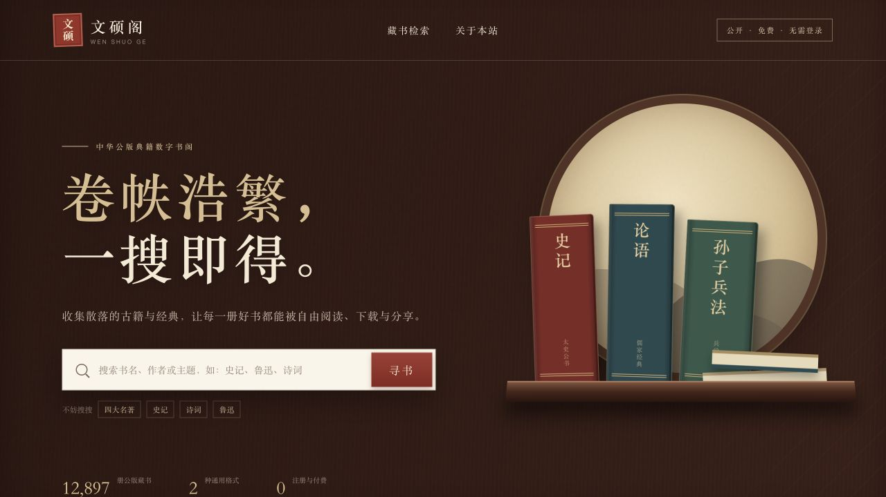

# 📚 文硕阁 · 中文公版书数字书阁

<div align="center">

**传承中华文化瑰宝 · 免费分享公版经典**

[🌐 在线访问](https://www.wenshuoge.com/) · [🔎 检索藏书](https://www.wenshuoge.com/#library) · [📖 电子书目录](#电子书列表)

</div>

---

## 🖼️ 网站预览

[](https://www.wenshuoge.com/)

> 正式站点已部署至 Cloudflare：**[www.wenshuoge.com](https://www.wenshuoge.com/)**

## 📖 关于文硕阁

大家好！我是文硕阁的创建者，一个热爱中华传统文化的公版书爱好者。

文硕阁致力于收集、整理和分享已经进入公共版权领域的中文经典著作，让这些文化瑰宝能够被更多人轻松检索、阅读和下载。网站完全公开免费，无需登录注册，不设会员，也没有广告。

## ✨ 网站能力

- 🔎 **即时检索**：支持按书名、作者和主题检索全部藏书
- 🗂️ **分类浏览**：自动归纳 15 个门类，可按类别直接浏览藏书
- 🧾 **增强书目**：分批核验简介、标签、作者小传、成书年代与资料来源
- 📚 **双格式取阅**：提供 EPUB、PDF 两种常用电子书格式
- 📖 **在线续读**：EPUB 可直接在浏览器内翻页，阅读位置只保存在当前浏览器
- 📊 **下载统计**：按书籍和格式展示去重后的下载次数
- 🛡️ **下载防刷**：短时频率、单日数量、批量取书和临时凭证多重限制
- 🌐 **好书分享**：支持系统分享、复制链接及 16 个国内外社交平台入口
- 🪵 **拟物化设计**：木质书架、实体封面、宣纸与印章视觉效果
- 📱 **响应式布局**：适配桌面电脑、平板和手机
- 🌏 **全球边缘访问**：网站与电子书均由 Cloudflare 网络提供服务
- 🆓 **完全公开免费**：无需登录、无需注册、无会员、无广告

## 🧱 技术架构

网站前端、检索索引和电子书文件均可运行在 Cloudflare 服务中：

| 组件 | 用途 |
|:---|:---|
| **Cloudflare Workers** | 路由、电子书访问接口与安全响应头 |
| **Workers Static Assets** | 托管 HTML、CSS、JavaScript、封面和检索索引 |
| **Cloudflare R2** | 存放 `ebookfiles` 中的 EPUB、PDF 文件 |
| **Cloudflare D1** | 保存临时下载凭证、去重下载事件与累计统计 |
| **Wrangler** | 本地开发、类型生成、R2 管理和生产部署 |
| **自动索引脚本** | 从 EPUB 提取元数据，生成分类、时代、标签、检索索引和详情分片 |

电子书通过 Worker 从 R2 流式返回，并支持 HTTP Range 分段读取，适合在线打开较大的 PDF 文件。公开检索索引经过紧凑化处理，当前约为 **1.90 MB**；书籍简介与来源按编号分片，只有打开详情时才按需加载。

### 项目目录

```text
├── ebookfiles/          # EPUB、PDF 原始电子书
├── metadata/batches/    # 分批核验的增强书目与互联网来源
├── public/              # 网站页面、样式、脚本和生成后的书目索引
├── scripts/             # 书目索引与 R2 上传脚本
├── src/                 # Cloudflare Worker 入口
├── docs/images/         # README 网站预览图
└── wrangler.jsonc       # Cloudflare 部署与绑定配置
```

## 🚀 开发与部署

### 本地运行

```bash
npm install
npm run dev
```

打开 `http://localhost:8787` 即可预览。书目检索可完整使用；本地 R2 未放入文件时，下载入口会提示文件尚未同步。

### 部署到 Cloudflare

首次部署前登录 Cloudflare，检查 R2 存储桶是否存在：

```bash
node node_modules/wrangler/bin/wrangler.js login
node node_modules/wrangler/bin/wrangler.js r2 bucket list
```

如果列表中没有 `wenshuoge`，再创建存储桶：

```bash
node node_modules/wrangler/bin/wrangler.js r2 bucket create wenshuoge
```

上传电子书并发布网站：

```bash
npm run upload:books
npm run deploy
```

`npm run deploy` 会先把 `migrations` 中尚未执行的 D1 迁移应用到远程下载统计库，再发布 Worker。当前项目已经绑定 `wenshuoge-metrics`；若在另一个 Cloudflare 账户部署，可移除或替换该绑定的资源 ID，由 Wrangler 自动配置新数据库。只想单独更新远程数据结构时可运行 `npm run migrate:remote`。

### 下载统计与安全规则

- 在线阅读使用独立的短期只读凭证，不暴露可枚举的原始地址，也不计入下载次数。
- 下载前必须取得 5 分钟有效的临时凭证，原始文件地址不能直接批量抓取。
- 同一网络与浏览器环境对同一书籍、同一格式每天只统计一次，重复请求不会刷高数量。
- 每 10 分钟最多发起 8 次下载，且最多涉及 5 本不同书籍；每天最多发起 25 次。
- 服务端只保存由网络地址与浏览器标识生成的 SHA-256 摘要，不保存原始 IP；临时记录会定期清理。
- 部分平台没有开放网页直发接口，网站会复制推荐语与书籍链接，并提示读者前往对应 App 完成分享。

`wrangler.jsonc` 已配置自定义域名 `www.wenshuoge.com`。域名需要位于同一个 Cloudflare 账户中；首次部署时 Cloudflare 会创建对应的 Worker 自定义域名记录。

R2 对象使用 `ebookfiles/<编号>/<文件名>` 作为存储键。每次新增电子书后，执行 `npm run index` 即可重建检索索引；`npm run check` 可在发布前完成类型检查与 Cloudflare 部署预检。

## 🧾 书目增强与分批整理

当前全部 **12,897** 册已根据书名、原始主题和简介自动划分统一分类与成书时代；缺少原始主题的书籍会自动补上分类和时代作为基础标签。

互联网核验采用可持续的分批机制：每一批在 [`metadata/batches`](metadata/batches/) 增加一个 JSON 文件，记录核验后的作者信息、成书年代、标签、简介和公开来源。运行 `npm run index` 后，新批次会自动合并到网站，而不会改写 EPUB 原文件。

目前已完成 **119 批、2,495 册**资料核验，其中 2,488 册为逐册增强，7 册为经书名与作品关系确认后的同作品版本继承；尚余 **10,402 册**等待后续分批核验。自第 061 批起，每批固定处理 30 册（遇缺号顺延补足）。

第 119 批完成编号 3366—3395 共 30 册：补齐《顾华玉集》《标准与尺度》《论雅俗共赏》《唐宋传奇集》《甫田集》《浮溪集》《甫里集》《滏水集》《傅雷家书》《清代散文名篇》《甘泉先生续编大全》《高阳诗文集》等历代诗文、文学评论、小说、理学、政史与近现代人文书目的简介、作者及辑编责任、成书年代、分类、标签和可追溯来源。将《论雅俗共赏》《甫田集》《傅雷家书》由年代待考订正为近现代、明代、近现代，将《唐宋传奇集》由隋唐五代订正为近现代并由戏曲改归小说，将《浮溪集》《甫里集》《滏水集》分别由明代、明代、宋代订正为宋代、唐代、金代。30 册均同时具备 EPUB 与 PDF，逐章及百字以上长段落审计均未发现重复；《高阳诗文集》有 1,622 处方框缺字，残损严重，《唐宋传奇集》《傅与砺诗文集》各 5 处，《甫田集》《甘泉先生续编大全》各 4 处，其余为零至三处。《顾华玉集》当前合收六种别集，《浮溪集》只实收三十二卷而未见拾遗，《覆瓿集》目录把附录标成卷八，均按实书说明。《傅雷家书》当前文件还收楼适夷代序、傅聪家书及 1987 年译注文章，整体并非可直接认定的公版文件，详情页已明确提示下架受保护部分或取得许可；《读禅阅世》《闻一多散文集》《清代散文名篇》《徐志摩散文集》均提示原作公版与现代选编、年表、参考书目等版本层权利须分开核验。

第 118 批完成编号 3336—3365 共 30 册：补齐《果堂集》《国琛集》《海壑吟稿》《海陵集》《海忠介公集》《韩集举正》《唐玄宗文集》《高子遗书》《攻媿集》《晚清文选》《镡津集》《古欢堂集》《古灵集》等经学、人物传记、历代诗文、佛教论著与近现代散文的简介、作者及辑编责任、成书年代、分类、标签和可追溯来源。将《韩集点勘》由魏晋南北朝订正为清代，《宫教集》由明代订正为宋代，《格斋四六》由年代待考核定为宋代。30 册均同时具备 EPUB 与 PDF；审计发现《唐玄宗文集》有 6 组完全相同篇章重复，《攻媿集》卷十一误嵌提要、原序及前十卷正文并形成 195 组百字以上重段，《晚清文选》《古欢堂集》各有 1 组长段复见，其余未见整章或长段落重复。《峤雅》有 570 处方框缺字，《韩集举正》400 处、《高子遗书》189 处、《攻媿集》97 处、《晚清文选》53 处、《海忠介公全集》43 处，其余为零至十六处。《晚清文选》原分上中下三卷，当前电子本只是拆成 35 个导航卷；《古欢堂集》实收本集三十七卷、《黔书》二卷及《长河志籍考》十卷，共四十九卷。《知性》所收林徽因原作已进入公版，但附录梁从诫《倏忽人间四月天》尚未进入公版，详情页已作删除或授权提示；《缘缘堂随笔》原作于 2026 年在中国大陆已届作者终身加五十年保护期之外。

第 117 批完成编号 3306—3335 共 30 册：补齐《鹤林集》《横浦集》《横塘集》《胥台集》《鹤山集》《鸿庆居士集》《衡庐精舍藏稿》《后苏龛合集》《语文影及其他》《广成集》《归田类稿》《圭峰集》《龟山集》《还山遗稿》等诗文别集、理学论著、道教文献与近现代散文的简介、作者及辑编责任、成书年代、分类、标签和可追溯来源。将《鹤林集》《洪龟父集》《圭峰集》分别由清代、明代、明代订正为宋代、宋代、元代，并确认《广成集》为晚唐五代作品。30 册均同时具备 EPUB 与 PDF，逐章审计及百字以上规范化长段落审计均未发现重文；《后苏龛合集》有 3,067 处方框缺字，《还山遗稿》136 处、《龟巢稿》117 处，《圭斋集》16 处、《胥台集》13 处，其余为零至十处。《后苏龛合集》核为黄典权据手稿整理、台湾银行经济研究室 1965 年排印的版本，诗钞卷五全佚；《语文影及其他》是朱自清生前自编、1985 年首次出版的遗稿集，两书详情页均提示原作与现代整理、排印层分开核权。《广成集》当前为四库十二卷本，不与《正统道藏》十七卷本混用；《归田类稿》实收四库二十二卷，而《总目》二十四卷著录与实书不合；《圭峰集》是删去误收陈旅、萨都剌诗后的四库二卷重编本；《还山遗稿》的明代辑者已由旧简介误写的“宋廷佑”核正为宋廷佐。

第 116 批完成编号 3276—3305 共 30 册：补齐《湖山类稿》《花溪集》《华阳集》《环谷集》《槐野先生存笥稿》《洹词》《淮海集》《晦庵集》《汉魏六朝百三家集》《翰苑集》《何水部集》《赤城集》《河东集》《河南集》等诗文别集、理学著作与政史文献的简介、作者及辑编责任、成书年代、分类、标签和可追溯来源。将《湖山类稿》《华阳集》《环谷集》《尽言集》《嵇中散集》分别由明代、明代、先秦、明代、明代订正为宋代、唐代、元代、宋代、魏晋南北朝，并将《黄御史集》《会昌一品集》《翰苑集》由宽泛的隋唐五代规范为唐代。30 册均同时具备 EPUB 与 PDF，逐章审计未发现整章重复；《槐野先生存笥稿》发现 1 组、《汲古堂集》发现 2 组百字以上规范化长段落重文。《汉魏六朝百三家集》有 154 处方框缺字，《槐野先生存笥稿》49 处，《晦庵集》38 处，《汲古堂集》23 处，《洹词》16 处。《湖山类稿》当前是刘辰翁选评五卷旧本，不与现代增订本混用；《黄御史集》当前实收八卷且无附录，十卷著录存在版本争议；《何水部集》核为正德十二年张纮刊一卷本；《赤城集》当前十八卷只存文一百八十二篇，原本诗十卷已散佚；《河东集》以十五卷正文和张景所撰行状合排为十六卷。《斯未信斋文编》《斯未信斋杂录》为台湾银行经济研究室 1960 年前后的机构选编本，详情页已提示清人原作与现代选编、标点层应分开核权。

第 115 批完成编号 3246—3275 共 30 册：补齐《克斋集》《可斋杂稿》《寄鹤斋选集》《济南集》《语文零拾》《春》《集古录》《姜斋文集》《香艳丛书》《荒政丛书》《好古堂书目》等理学文献、诗文别集、金石鉴藏、近现代散文与政史资料的简介、作者生平、辑编责任、成书年代、分类、标签和可追溯来源。将《济南集》《集古录》分别由明代、隋唐五代订正为宋代，《荒政丛书》由宋代订正为清代，《香艳丛书》由年代待考订正为近现代；并按核心内容把《克斋集》《兼济堂文集》《姜斋文集》《蛟峰文集》《絜斋集》《节孝集》归入诸子哲思，《可斋杂稿》《建康集》《见素集》《椒邱文集》《金文靖集》《荒政丛书》《好古堂书目》归入史地文献，《语文零拾》归入语言文字，《集古录》归入艺术鉴藏，《香艳丛书》归入综合其他。30 册均同时具备 EPUB 与 PDF，逐章审计未发现整章重复；《香艳丛书》发现 2 组百字以上规范化长段落重文，并有 60 处方框缺字；《矫亭存稿》有 183 处方框缺字且当前只实收八卷，明显少于书目所载存稿十八卷、续稿八卷；《集古录》有 93 处、《寄鹤斋选集》25 处方框缺字。《姜斋文集》卷六《九砺》全阙且卷八另缺一篇；《建康集》当前实收八卷，与十卷旧著录并存；《荒政丛书》当前实收十卷及附录，旧简介所称五卷实为数字文件册数误识；《好古堂书目》文件还合收《宋元版本书目》《好古堂书画记》和《续收书画奇物记》。《春》核为 1933 年出版的十四篇散文集，并非同名名篇单篇；《寄鹤斋选集》对应 1972 年前后的机构选编本，详情页已提示古人原作与现代选编层应分开核权。

第 114 批完成编号 3214—3245 共 30 册（3221、3222 号文件不存在，顺延补入 3244、3245）：补齐《妙绝古今》《半农杂文》《李太白集分类补注》《清江三孔集》《梁溪集》《静庵文集》《茅盾散文集》《九灵山房集》等总集、别集、近现代文学与政史文献的简介、作者生平、辑编责任、成书年代、分类、标签和可追溯来源。将《李太白集分类补注》由清代订正为以李白原作为主体的唐代文献，《李文公集》《李太白文集》《刘宾客文集》由隋唐五代规范为唐代，《缙云文集》由明代订正为宋代，《句曲外史集》由明代订正为元代；《半农杂文》《静庵文集》《茅盾散文集》归入近现代人文，《李文公集》《泾皋藏稿》《景迂生集》《敬轩文集》《静修集》《康斋文集》归入诸子哲思，《梁溪集》《经济文集》《矩山存稿》归入史地文献。30 册均同时具备 EPUB 与 PDF，逐章审计未发现整章重复；《泾皋藏稿》因当前文件合收光绪本与四库本，在对应篇章间发现 3 组完全相同的长段落，并有 23 处方框缺字；《半农杂文》有 53 处、《经济文集》18 处、《景迂生集》14 处，其余为零至七处。《清江三孔集》补全孔文仲、孔武仲、孔平仲及王璧辑编责任；《九灵山房集》当前只实收三十卷和补编二卷，不含后出遗稿四卷；《宋景文集》当前只实收六十二卷，不含提要所称补遗二卷。《茅盾散文集》当前文件为约 303 篇、未署编者和底本的大型后出汇编，并非可据旧简介确认的单一历史版本；茅盾作品在中国大陆通常仍受保护至 2031 年末，在作者终身加 70 年地区通常仍受保护至 2051 年末，详情页已加入版本及版权风险提示。

第 113 批完成编号 3183—3213 共 30 册（3201 号文件不存在，顺延补入 3213）：补齐《梁溪遗稿》《两溪文集》《林忠宣公集》《临川集》《骆丞集》《巴黎的鳞爪》《闲书》《民族文话》等诗文别集、近现代文学与史地著述的简介、作者生平、成书年代、分类、标签和可追溯来源。将《林登州集》《临安集》订正为明代，《麟角集》《骆丞集》《黎岳集》《李北海集》订正为唐代，《阆风集》订正为宋代，《吴礼部集》订正为元代；《巴黎的鳞爪》《古庙集》《闲书》归入近现代人文，《浪语集》归入诸子哲思，《民族文话》归入史地文献。文件审计确认 30 册均同时具备 EPUB 与 PDF：《林忠宣公集》正文实际由六组稿本合计 21 卷组成，并有 123 处方框缺字；《十先生奥论注》目录列 45 卷，但续集前五卷仅存缺文标记，前集一至七卷又为后人抄补且缺原注；《两溪文集》附录与后序之间发现 8 组长段落重复；《黎岳集》保留一首异文重出及一处题文错配提示；《古庙集》的初版年份依据馆藏书目订正为 1929 年。《民族文话》作者郑振铎卒于 1958 年，作品在中国大陆已进入公版，但在采用作者终身加 70 年保护期的地区可能仍受保护至 2028 年末，详情页已加入地域版权提示。

第 112 批完成编号 3152—3182 共 30 册（3174 号文件不存在，顺延补入 3182）：核定《陵川集》《刘随州集》《刘左史集》《龙川集》《卢溪集》《鲁斋遗书》《李义山文集笺注》《笠泽丛书》等诗文别集、理学著述、艺术鉴藏与史地文献的作者、辑编责任、时代、卷帙和版本系统。将《刘随州集》《李遐叔文集》《李元宾文编》《笠泽丛书》订正为唐代，《刘左史集》《龙川集》《卢溪集》订正为宋代，《鲁斋遗书》订正为元代；并按核心内容把《龙川集》《鲁斋集》《鲁斋遗书》归入诸子哲思，《楼居杂著》归入艺术鉴藏，《鹿忠节公集》《潞公集》《李文节文集》归入史地文献。规范化 EPUB 长段落审计未发现整章或长段落重复；《李文节文集》有 3,476 处方框缺字，且目录和正文均由卷十四直接跳至卷十九，确认整缺卷十五至十八，文本残损极重；《陵川集》有 24 处、《鲁斋集》有 12 处、《柳如是集》有 8 处，其余为零至七处。《刘左史集》所收《周礼》第四篇开头缺四行且仅一行可补，《李元宾文编》外编缺一篇全文并有散处脱文，《李遐叔文集》四库本剔除了两篇误收李翱文章，《莲峰集》为原三十卷散佚后从《永乐大典》辑成的十卷本。《柳如是集》为多种旧刻与后出材料的合编本，当前文件未署现代汇编责任，详情页已增加编排来源核查提示。

第 111 批完成编号 3122—3151 共 30 册：核定《欧阳文粹》《佩韦斋集》《鄂州小集》《罗昭谏集》《吕衡州集》《梅村集》《天下同文集》《四六法海》《刘蕺山集》等历代诗文别集、文章总集、理学著述与地方文献的作者、选编责任、时代、卷帙和版本系统。将《欧阳文粹》的著作责任由陈亮单署订正为欧阳修撰、陈亮编；将《罗昭谏集》订正为唐代，《梅岩文集》《梅山续稿》《严陵集》订正为宋代，《密庵集》《四六法海》《刘蕺山集》订正为明代；并按核心内容把《勉斋集》《刘蕺山集》归入诸子哲思、《严陵集》归入史地文献、《四六法海》归入诗词文集。规范化 EPUB 长段落审计未发现整章或长段落重复；《渼陂集》有 3,910 处方框缺字，文本残损极重，《梅溪集》有 18 处，其余为零至四处。《天下同文集》虽保留五十卷框架，但卷十七、十八、三十、三十一、三十四、三十五、四十一仅存“阙”字，实际有正文四十三卷；《吕衡州集》卷六、七为后人从类书补辑且仍有志铭缺篇，《勉斋集》所据系统至少十三篇存在内部脱文，《凌忠介公集》未收重要奏疏，《刘蕺山集》为删去《人谱》《学言》等专著后的十七卷重编本，均已在详情页明确提示。《梅花道人遗墨》误收鲜于枢诗，部分题画作品的真伪亦待考。

第 110 批完成编号 3092—3121 共 30 册：核定《粤西三载》《钤山堂集》《皮子文薮》《少室山房集》《王尽美文集》《曝书亭集》《南轩集》《念庵集》《欧阳修撰集》《欧阳行周文集》《盘洲文集》等地方文献、历代别集、理学著作与近现代人文资料的作者、年代、卷帙、辑编责任和版本系统。纠正《欧阳修撰集》的关键误识：作者是南宋欧阳澈，“修撰”为追赠官称，并非欧阳修；同时将《欧阳行周文集》由明代订正为唐代。按核心内容把《粤西三载》《倪石陵书》归入史地文献，《王尽美文集》归入近现代人文，《南轩集》《念庵集》归入诸子哲思，《牧潜集》归入佛教典籍。规范化 EPUB 长段落审计未发现整章或长段落重复；《皮子文薮》当前只有御制诗和提要，十卷正文全部缺失，《钱塘集》缺卷十三、十四，《默成文集》只存八卷系统的卷一至四，《倪文贞集》只收正编十七卷和续编三卷，均已在详情页醒目标明。《淇园编》有 286 处方框缺字，《粤西三载》79 处，《蠛蠓集》48 处；《王尽美文集》还因未署现代选编来源，增加了编排来源与地域性权利核查提示。

第 109 批完成编号 3062—3091 共 30 册：核定《青山集》《青阳集》《清閟阁集》《四六标准》《秋涧集》《曲江集》《权文公集》《清容居士集》《蒲室集》《看云集》《永日集》等诗文别集、禅林文学与近现代散文的作者、年代、卷帙、辑编责任和版本系统；将《青山集》《秋涧集》《佩玉斋类稿》订正为元代，《清正存稿》《臞轩集》《秋崖集》《平斋文集》《毘陵集》订正为宋代，《权文公集》订正为唐代，并把《蒲室集》归入佛教典籍。规范化 EPUB 长段落审计未发现整章或长段落重复；《丘文庄公集》有 20 处方框缺字，《四六标准》有 17 处，其余为零至八处。《权文公集》当前是明嘉靖杨慎据残本刊行的诗赋十卷本，不是五十卷《权载之文集》；《平斋文集》正文从讲义开篇，确认属于四库讲义、故事及文章三十二卷系统，并非以赋、诗开卷的另一宋本系统；《青溪漫稿》《清献集》《曲江集》《俟庵集》等也均按文件实收卷次与其他传本区分。周作人《看云集》《永日集》在中国大陆按作者终身加五十年规则已进入公版，但其他司法辖区可能适用更长期限，详情页已提示区域性权利差异。

第 108 批完成编号 3032—3061 共 30 册：核定《仁山集》《容春堂集》《榕村集》《三鱼堂文集》《圣祖仁皇帝御制文集》《泉翁大全集》《山谷集》《曾文正公全集》等理学著述、诗文别集与综合文献的作者、年代、卷帙、辑编责任和版本系统；将《文宪集》由元代订正为明代，并按内容把《三鱼堂文集》《冯少墟集》《泉翁大全集》归入诸子哲思、《曾文正公全集》归入近现代人文。规范化 EPUB 长段落审计未发现整章或长段落重复；《泉翁大全集》有 3,880 处方框缺字，《山窗余稿》有 115 处，均已作显著残损提示。《三鱼堂文集》当前只收正文十二卷，未收通行本的外集六卷和附录；《山海漫谈》当前只收正文三卷，未收附录二卷；《曾文正公全集》是后期增广汇编，当前目录缺书札卷十，且奏稿、杂钞、文集、诗集、杂著卷数均与旧简介所称一百五十四卷本不一致，现已按实际文件逐项说明。《尚絅斋集》保留六篇有录无书的底本原缺，《钱仲文集》末附《江行无题一百首》实际为钱珝作品。其余各书的实收卷次、缺字与辑佚本特征均已逐册提示。

第 107 批完成编号 3002—3031 共 30 册：核定《汤子遗书》《文忠集》《容台集》《师山文集》《石门文字禅》《使署闲情》《苏魏公文集》等理学著述、诗文别集、佛教文学与台湾文献的作者、年代、卷帙、辑编责任和版本系统；将《师山文集》《石门集》《说学斋稿》订正为元代、《双溪类稿》订正为宋代，并按作品主体把《汤子遗书》《恕谷后集》归入诸子哲思、《石门文字禅》《全室外集》归入佛教典籍、《使署闲情》归入史地文献。规范化长段落审计未发现整章或长段落重复；《容台集》有 83 处方框缺字，《文忠集》有 67 处。《泰泉集》原为十卷，当前目录和正文只收卷二至卷十，明确缺卷一；《文忠集》当前实收正文二百卷及附录五卷，不含另行著录的年谱一卷；《容台集》采用文集十卷、诗集四卷、别集六卷的二十卷系统，不能按十七卷初刻本误判；《少阳集》是四库删定六卷本；《省斋集》原四十卷及别稿十卷均佚，当前十卷为四库辑本；《阮籍集》当前四卷另附录，与一卷、二卷及六卷本分属不同系统；《全室外集》续编所据底本在诗文之间原缺四页。其余各书的实收卷次、缺字和版本差异均已逐册提示。

第 106 批完成编号 2972—3001 共 30 册：核定《王著作集》《王荆公诗注》《水云村稿》《松泉集》《宋景濂未刻集》《水心集》等别集、辑佚本与近代文献的作者、年代、卷帙、编纂责任和版本系统；将《王著作集》《唯室集》《松隐文集》《崧庵集》订正为宋代，《司空表圣文集》《孙可之集》订正为隋唐五代，《松乡集》订正为元代，《潜溪集》《宋布衣集》订正为明代，并将《台湾诗荟杂文钞》归入近现代人文、《水心集》归入诸子哲思。规范化长段落审计未发现整章或长段落重复；《宋布衣集》有 77 处方框缺字，《宋景濂未刻集》有 72 处，后者并列收录四库本二卷与家藏本，缺字主要集中在家藏本。《松隐文集》虽保留四十卷编号，卷十四仅存“原阙”说明；《水云村稿》原目二十卷，当前实存十五卷；《王著作集》八卷中，王蘋本人遗文只占前两卷的一部分，其余多为传记、像赞与题跋；《惟实集》也平行收有四库本和一套未署整理者的标点本，现代标点层权利仍待核实。《松桂堂全集》实为正集三十七卷加《延露词》三卷，《水心集》当前二十九卷系统不含另行著录的别集十六卷。其余各书的实收卷次、缺字与版本差异均已逐册提示。

第 105 批完成编号 2942—2971 共 30 册：核定《文简集》《文山集》《黄文献集》《欧阳文忠集》《吴文正集》《宛陵集》《王文端公集》等诗文别集的作者、时代、卷帙、编纂责任与版本系统；将《文恭集》《文庄集》由明代订正为宋代，《闻过斋集》《吴文正集》订正为元代，《陶学士集》订正为明代，《铁庵集》由年代待考订正为宋代，并把《陶山集》归入诗词文集、《铁庐集》归入诸子哲思。规范化长段落审计未发现整章或长段落重复；《欧阳文忠集》有 525 处方框缺字，《王文端公集》有 1,294 处，后者文本残损尤其严重。《铁庐集》当前只收正集三卷、外集二卷，未收书目所载《后录》一卷；《王常宗集》未收《续补遗》一卷；《唐愚士诗》当前四卷编排与四库提要所述主集、附集体系不同；《吴文正集》沿用本身已有三篇缺文及一篇残文的百卷重刊系统。其余各书实收卷次、缺字与版本差异均已逐册提示。

第 104 批完成编号 2912—2941 共 30 册：核定《勿轩集》《武溪集》《西陂类稿》《逊志斋集》《西台集》《渭南文集》《文木山房集》等诗文别集的作者、年代、卷帙、编纂责任与版本系统；将《西隐集》由元代订正为明代、《文泉子集》由明代订正为隋唐五代，并按内容把误列综合典籍的《西台集》归入诗词文集。文件审计确认《荥阳外史集》原一百卷，当前虽保留连续卷号，实际缺三十七卷、实存六十三卷；《西河集》应有一百九十卷，但卷六节点误装卷七全文，形成缺卷六并完整重复卷七，另有三十四处方框缺字和十三段由整卷重收造成的重文；《蟋蟀轩草》当前十三卷与存目所载四卷本系统不同，且有 418 处方框缺字。《文泉子集》是原十卷散佚后的六卷辑本，《晞发集》《西塘集》《西山文集》等也存在原集散佚、附录增补或附属著述未收情形；其余各书的实收卷次、缺字与重复情况均已逐册提示。

第 103 批完成编号 2882—2911 共 30 册：核定《竹洲集》《香屑集》《象山集》《谢叠山全集校注》《遗山集》《徐孝穆集笺注》《午亭文编》等诗文别集、思想文献与现代整理本的作者、年代、卷帙、编纂责任和版本系统；将《香屑集》从年代待考订正为清代、《襄陵文集》《谢叠山全集校注》订正为宋代、《遗山集》订正为金代、《午亭文编》订正为清代、《梧溪集》订正为元代，并把《象山集》《旴江集》《虚斋集》归入诸子哲思、《学古绪言》归入文学评论。规范化长段落审计未发现整章或长段落重复；《遗山集》平行收完整四库四十卷本及一套未署整理者的现代标点本，后者缺卷三十二、三十六、三十八、四十一，全文件有 338 处方框缺字。《谢叠山全集校注》核为 1995 年现代校注成果，宋人原作虽属公版，现代校勘、注释与编排的权利仍须另行核实。《谢文庄公集》传统提要记集末疑有脱叶，《梧冈集》只保存作者全部著述的一部分，《萧茂挺文集》则是原十三卷散佚后的单卷辑存；其余各书的实收卷次、缺字和版本差异均已逐册提示。

第 102 批完成编号 2852—2881 共 30 册：核定《苑洛集》《宗子相集》《宗玄集》《紫山大全集》《庄渠遗书》《魏武帝集》《魏文帝集》《昭明太子集》等别集与思想文献的作者、年代、卷帙、版本系统和辑编责任；将《徐文长集》订正为明代、《拙轩集》《庄靖集》订正为金代、《杼山集》订正为隋唐五代、《昭明太子集》订正为魏晋南北朝，并将《宗玄集》《庄渠遗书》分别归入道教典籍、诸子哲思。文件审计确认《宗子相集》把提要及卷一至卷十五完整重收一遍；《陈记室集》《王侍中集》的 EPUB、PDF 都只有封面、制作说明和目录，完全没有正文。《宗玄集》现存三卷只保留权德舆序所称四百五十篇中的一百一十九篇，别录又附入被四库馆臣明确辨伪的《内丹九章经》；《魏文帝集》核为丁福保《汉魏六朝名家集初刻》六卷本，不按张溥二卷本误判缺卷。《徐文长集》《庄靖集》分别存在 1016、91 处方框缺字，其余各书的卷次和文件质量问题也已逐册提示。

第 101 批完成编号 2822—2851 共 30 册：核定《龙湖文集》《湛然居士集》《云溪居士集》《高宗御制文集》《重编琼台会稿》《至正集》《止斋文集》等诗文别集与御制总集的作者、年代、卷帙、版本系统和复合编纂责任；将《湛渊集》订正为元代，将《筼窗集》《忠正德文集》《忠惠集》《止斋文集》订正为宋代，并订正丘濬籍贯。规范化长段落审计未发现逐字重复；《高宗御制文集》实收初集三十卷、二集四十四卷、三集十六卷及余集二卷，共九十二卷，《至正集》卷十、卷十一虽合在同一阅读节点，两卷正文均已收录。文件审计确认《中峰文选》只收正文卷一至卷三和《中峰应制稿》，少于六卷初刻本与十一卷重刻本；《夏忠靖集》第二个“附录”是电子整理时拼入的书目、方志和他人文集资料，编者与来源未署。另辨明《止堂集》当前十八卷、《中庵集》当前二十卷均属于独立版本系统，不误判为缺卷；《云溪居士集》《竹隐畸士集》《竹轩杂著》《刘忠肃集》等为原集散佚后的四库重辑本。《龙湖文集》《荆川先生文集》《至正集》等存在较多方框缺字，相关问题均已逐册提示。

第 100 批完成编号 2792—2821 共 30 册：核定《云台编》《演山集》《东维子集》《云峰集》《袁中郎全集》《御制乐善堂全集定本》《长兴集》《张燕公集》等诗文别集，以及《原本韩集考异》的作者、时代、卷帙、版本系统和复合编纂责任；将《东维子集》由明代订正为元代，把《原本韩集考异》改列文学评论，并订正罗钦顺籍贯、张玉书表字及张说表字。文件审计确认《东维子集[标点本]》缺卷九，并有两篇文章、三个长段落组重收；《云峰集》只收正文八卷，所谓“附录”实为混入的其他书目提要，历史附录二卷未收；《郁洲遗稿》缺卷九、卷十，《雪楼集》缺卷二十一，《贞白遗稿》未收《显忠录》二卷。另辨明《知非堂稿》当前为独立六卷诗集系统，《长兴集》为原四十一卷散佚后的十九卷重编本，《张燕公集》为通行二十五卷本，均不误判为电子文件缺卷；《东维子集[标点本]》未署标点者与底本，《袁中郎全集》等多书存在较多方框缺字，相关问题均已逐册提示。

第 099 批完成编号 2760—2791 共 30 册，编号 2763、2778 在原始书库中不存在：核定《艺苑卮言》《升庵诗话》《诗人玉屑》《诗品》《乐府古题要解》《六一诗话》等诗学文献，以及《全唐诗》《元氏长庆集》《云庄集》《尧峰文钞》《明太祖文集》等总集、别集的作者、年代、卷帙和复合编纂责任。规范化长段落审计未发现逐字重复；《二十四诗品》保留旧题司空图和现代辨伪争议，《全唐诗》辨明九百卷正编后附河世宁《全唐诗逸》三卷，《千家诗》订正为旧题谢枋得七言本与王相五言本合成的清代通行四类本，并非刘克庄二十二卷原选。《船子和尚拨棹歌》《纳兰词》所含后世续辑也已分层著录。文件审计确认《藏海诗话》的 EPUB 与 PDF 都只有封面、说明和目录而完全没有正文；《全唐诗》有六百七十六处方框缺字；《诗人玉屑》带有据 1978 年上海古籍出版社本制作的未署授权电子录校层，《明太祖文集[标点本]》也未署标点者和底本，相关现代整理来源与权利均已标记待核。

第 098 批完成编号 2730—2759 共 30 册，核定《竹庄诗话》《国雅品》《诗镜总论》《四溟诗话》《姜斋诗话》《渔洋诗话》《䂬溪诗话》《诗话总龟》等宋明清诗论，以及《空轩诗话》《石遗室诗话》两种近现代文献的作者、年代、卷帙、异名、辑编责任与文件实收内容。规范化长段落审计未发现逐字重复；《姜斋诗话》明确标作后世汇编题名，《紫薇诗话》辨明为标点本与四库本两套平行文本，《后山诗话》保留作者归属争议，《诗话总龟》则把阮阅原编与后世合并增修责任分层著录。另将《石遗室诗话》由清代订正为近现代，将《诗镜总论》《䂬溪诗话》《珊瑚钩诗话》分别订正为明代、宋代、宋代，并把《竹庄诗话》《答万季埜诗问》《白石道人诗说》《续诗话》《诗话总龟》改列文学评论。文件审计确认《石遗室诗话》实收正编三十二卷、续编六卷；吴景旭《历代诗话》虽列八十卷，卷四十四却仅余“年谱，下缺”一句，属于明确残卷；吴宓《空轩诗话》成于 1934 年且作者卒于 1978 年，已标为非公版、禁止未授权分享。

第 097 批完成编号 2700—2729 共 30 册，核定《抱真堂诗话》《石洲诗话》《养一斋诗话》《载酒园诗话》《风月堂诗话》等明清宋金诗话，以及《忍古楼词话》《定庵诗话》《诗史阁诗话》《藏斋诗话》等近现代诗论的作者、年代、卷帙、传本和文件实收内容。规范化长段落审计未发现逐字重复；《高斋诗话》《陈辅之诗话》《蔡宽夫诗话》均明确标出郭绍虞现代辑佚、题目、校记和案语层，《五代诗话》订正为王士禛原编、郑方坤删补，《西清诗话》辨明为三卷旧本系统。另将《滹南诗话》由宋代订正为金代，将《尊瓠室诗话》《定庵诗话》《诗话后编》《蕉庵诗话》订正为近现代，把《闽川闺秀诗话》《蠲戏斋诗话》改列文学评论；《雕虫诗话》自序明确署民国三十五年，作者刘衍文卒于 2021 年，已标为非公版、禁止未授权分享。《石洲诗话》《五代诗话》《载酒园诗话》《辽诗话》等文件的少量缺字，以及《蠲戏斋诗话》未署汇编来源的问题，也均已逐册提示。

第 096 批完成编号 2670—2699 共 30 册，核定《全闽诗话》《钦定词谱》《梦窗稿》《瓯北诗话》等清宋诗词文献，以及《冷禅室诗话》《今传是楼诗话》《丽白楼诗话》《民权素诗话》等近现代诗话的作者、年代、卷帙、传本和文件实收内容。规范化长段落审计未发现逐字重复；《王直方诗话》《漫叟诗话》《潘子真诗话》《洪驹父诗话》《桐江诗话》《杨时诗话》《李希声诗话》均明确标出郭绍虞现代辑佚、补辑或辑录层，《民权素诗话》订正为蒋抱玄从杂志诗话栏辑成的十四种删节合集。《碧鸡漫志》通行五卷而当前仅四卷，《瓶粟斋诗话》当前仅五编二十三卷并《余渖》一卷，《曲海总目提要》虽四十六卷齐全却有九百三十处缺字；1986 年出版、作者卒于 2003 年的《梦苕庵诗话》明确标为非公版、禁止未授权分享。另把《春秋诗话》《瓯北诗话》《春酒堂诗话》的时代分别订正为清代，把《碧鸡漫志》《钦定词谱》改列文学评论，并订正《雅道机要》旧索引误写的作者“徐寅”为“旧题徐夤”。

第 095 批完成编号 2640—2669 共 30 册，核定《全汉诗》《古诗源》《箧中集》《十八家诗抄》等总集与别集，以及《全唐诗话》《夕堂永日绪论》《赌棋山庄词话》《后村诗话》《北江诗话》等诗词评论的作者、年代、卷帙、传本和文件实收内容。规范化长段落审计未发现逐字重复；《唐宋分门名贤诗话》原二十卷而当前只有前十卷正文，后十卷仅存目录；《诗式》是李壮鹰现代校注本，《时贤本事曲子集》是赵万里辑存五则的现代辑佚本，《古今诗话》是郭绍虞辑得四百四十四条并附校按的现代整理本，相关整理层来源和授权均待核。《全唐诗话》《诗法家数》分别保留旧题尤袤、旧题杨载及托名争议，《浩然斋词话》则说明为后人从《浩然斋雅谈》析出。另把《思怜诗》订正为明代作品，把《古诗源》《全汉诗》按清代编纂时代著录，把《夷白斋诗话》《古今诗话》《北江诗话》改列文学评论，并把《解人颐》改列综合其他。

第 094 批完成编号 2610—2639 共 30 册，核定《漱玉词》《白石道人歌曲》《玉台新咏》《范德机诗集》《听秋声馆词话》《东坡词》等诗词别集，以及《木天禁语》《诗学禁脔》《白香词谱》《二南密旨》《风骚要式》等诗法词话的作者、年代、卷帙、传本和文件实收内容。完整章节审计未发现逐字重复；《白石道人歌曲》末附一份明确题作“不全”的异本且有一千四百余个缺字，《玉台新咏》《王右军集》《白香词谱》《二南密旨》等亦存在缺字或编码损坏。《鲍参军集注》电子本实际只有六卷无注正文，《岑参集》是约一百七十八题的现代三卷编年选注本，《古诗十九首》附未署名现代译解，相关整理层来源和授权均待核；《珠玉词》《安陆集》《东坡词》等实收篇数或范围与通行著录不合。另把《古诗十九首》由综合其他订正为诗词文集，把《王右军集》《东坡词》的时代分别订正为魏晋南北朝、宋代，并对三种传统托名诗法书保留作者争议。

第 093 批完成编号 2580—2609 共 30 册，核定《好人歌》《词径》《介存斋论词杂著》等劝善与词学文献，以及《绝妙好词》《淮海词》《小山词》《逃禅词》《稼轩词》等二十三部宋人词集的作者、年代、卷帙、传本和文件实收内容。完整章节与规范化长段落审计未发现逐字重复；《绝妙好词》实收周密原编七卷及余集《续钞》，《彊村老人评词》是龙榆生据朱祖谋遗稿辑成的现代题名本，《逃禅词》平行收普通本与四库本两套文本，《稼轩词》仅为四卷二百余首系统。《山谷词》的现代注释来源与授权仍待核实，《东浦词》《丹阳词》《筠溪乐府》《溪堂词》《平斋词》等实收篇数少于通行著录，《审斋词》《稼轩词》《坦庵词》《平斋词》还有较多缺字占位符。另把《淮海词》由明代订正为宋代，把《逃禅词》由佛教典籍订正为诗词文集，并订正扬无咎姓氏及赵师侠作品数量等旧资料错误。

第 092 批完成编号 2550—2579 共 30 册，核定《问花楼词话》《艺圃撷余》《谈艺录》等明清诗词评论，《娇红记》《灌园记》《红拂记》三部传奇，《蒲江词》《梅溪词》《后村长短句》等宋人词集，以及《九辩》《三都赋》《己亥杂诗》《唐诗纪事》等作品的作者、年代、卷帙与文件实收内容。文件审计未发现完整章节逐字重复，但《后村长短句》七个数字分部之间发现至少九十七段明显重收；《处囊诀》原书已佚，当前仅五则辑存文字；《三都赋》缺《吴都赋》；《天地阴阳交欢大乐赋》为敦煌 P.2539 尾残写卷；《燕兰小谱》五卷齐全但未收后附《海瓯小谱》。另将《雨华盦词话》《红拂记》《九辩》《天地阴阳交欢大乐赋》等误判年代或分类订正，并标明《九辩》《梅溪词》《唐诗纪事》所含现代翻译、导言或整理层的来源与授权仍待核实。

第 091 批完成编号 2520—2549 共 30 册，核定《璇玑图诗读法》《历代词话》《田间诗学》等诗词评论与经学著作、《全史宫词》《岭云海日楼诗钞》《台湾诗乘》等诗史文献，以及《彩毫记》《昙花记》《琵琶记》和李渔八种传奇的作者、年代、体制、情节与文件实收内容。文件审计未发现逐字重复章节；《湘绮楼词钞》《七颂堂词绎》《吴礼部词话》等短本均按实收篇幅标明，《岭云海日楼诗钞》确认含十三卷正文及选外集、传记、年谱等附录。另将《宋太祖龙虎风云会》从隋唐五代订正为元末明初杂剧，将《田间诗学》从元代诗集订正为清初《诗经》学著作，并说明《二荷花史》作者无考、《吴礼部词话》实为从《吴礼部诗话》中辑出的七则词论。

第 090 批完成编号 2490—2519 共 30 册，核定民国《古今滑稽联话》、台湾古典诗集、明清别集与音韵著作、六朝诗文选、宋元诗集、清代词话与弹词、旧题宋玉四赋、前秦回文诗及梁氏父子联话总集的作者、年代、卷帙与实收内容。文件审计未发现逐字重复章节；《高太史大全集》的 EPUB 与 PDF 实际仅有封面和目录、完全没有正文，现已明确警示，不能误作十八卷足本；《伊川击壤集》有意并收标点本和四库本两套二十卷文本；《再生缘》第二十三回的正文按底本说明并入第二十四回，末五回虽有标题讹字但内容连续。另把吴儆由清代订正为南宋，把萧琛、王融、范云、陆倕订正为南朝，把《再生缘》改署陈端生、梁德绳与侯芝，并为《神童诗》和旧题宋玉四赋保留作者归属存疑说明。

第 089 批完成编号 2460—2489 共 30 册，核定五部明代传奇、《曲品》《远山堂曲品》《远山堂剧品》三部戏曲批评、清代《红灯记鼓词》、老舍二十种剧作及王夫之《鼓棹集》的作者、年代、体制、情节和文件实收内容。文件审计确认 30 册目录与正文连续，未发现逐字重复章节；《远山堂曲品》采用明代蓝格残稿并附黄裳校录，不能当作祁彪佳原书足本；《火车上的威风》是据《马裤先生》改写、1979 年才刊出的独幕剧。另把《红灯记鼓词》由明代订正为清代，把《青霞丹雪》《秦氏三兄弟》《火车上的威风》《归去来兮》《方珍珠》《残雾》《春华秋实》等误分类统一改回戏曲，并补上网站分类栏缺失的“文学评论”入口，使已核验的曲论、诗话和词话可以直接按类浏览。

第 088 批完成编号 2430—2459 共 30 册，核定十部明代传奇、老舍两种作品、清代诗词别集与诗词评论、长篇弹词《十粒金丹》、冯梦龙《山歌》和元明水浒杂剧的作者、年代、体制、传本及文件实收内容。文件审计确认《红大院》第三幕第一场正文逐字重复，后两章又连续误题第三幕第二场；《十粒金丹》两个第八回除标题略有删字外正文完全相同，并实缺第二十三回；《铁云诗存》采用刘蕙孙整理的 1980 年四卷本，但正文有十三处直接标“略”；《船山诗草》仅收通行二十卷本的前四部分，缺其余十六卷及补遗六卷。《金莲记》《春芜记》则只是章节分组标题写错，实际出目分别完整排至第三十六出和第二十九出。另订正吾邱瑞姓名、《春芜记》时代、梁清标与薛时雨等人的朝代分类，并把《词综偶评》《诗筏》《本事词》《小清华园诗谈》《词苑萃编》《憩园词话》等诗词评论改列文学评论。

第 087 批完成编号 2400—2429 共 30 册，核定清代秦腔《红鬃烈马》、王世贞与凌濛初等曲论、董解元《西厢记诸宫调》、泉州方言《梁山泊同窗琴书记》及二十四部明清传奇的作者、年代、出目、题材和传本。文件审计确认《精忠记》通行本三十五出，而当前目录与正文均从第五出直接跳到第七出，实缺第六出；《谭曲杂札》正文有十九个段落节点（其中一个仅为页码标记），与旧提要所称十五则不合；《紫箫记》现存三十四出是汤显祖本就未完成的早期稿，并非电子文件截断。对《绣襦记》《赠书记》《金雀记》《龙膏记》《玉环记》等保留署名异说，同时把《雨村曲话》从元代订正为清代、把《单本》还原为《蕉帕记》作者姓名；30 册现存正文均未发现逐字重复章节。

第 086 批完成编号 2370—2399 共 30 册，核定《永乐大典》戏文三种中的《张协状元》《宦门子弟错立身》《小孙屠》、南戏四大传奇系统、十二部元杂剧、汤显祖三梦及七部明代传奇和曲论的作者、年代、折出、故事来源与传本。文件审计确认《宝剑记》通行本五十二出而当前电子本仅到第三十四出，第二出且只存一个“缺”字；《雁门关存孝打虎》第一折并在楔子章节内，《罗李郎大闹相国寺》第二折标题误作楔子，并非整折缺失；《拜月亭记》的章节分组标题在第十出发生重叠。对《荆钗记》《杀狗记》《白兔记》《雁门关存孝打虎》《都孔目风雨还牢末》等保留署名异说，并把《冯京三元记》的原索引误署“沈龄”订正为沈受先；30 册现存正文均未发现逐字重复章节。

第 085 批完成编号 2340—2369 共 30 册，核定二十八部元明杂剧、传奇及李调元《雨村词话》的作者、年代、折出、题材和传本。文件审计确认《朱太守风雪渔樵记》当前以楔子直接接第四折，对照完整本确实缺第三折；《浣纱记》原作四十五出，当前目录和正文均缺第十六出《问疾》。《王月英元夜留鞋记》在曾瑞和无名氏之间、《刘玄德醉走黄鹤楼》在朱凯和无名氏之间、《鸣凤记》在王世贞、弇州门人与无名氏之间均有署名分歧，现保留异说；杨景贤、王子一、谷子敬等跨元明之际作家的剧作则按传本和活动年代分层著录。《雨村词话》四卷齐全，《鸣凤记》四十一出齐全，30 册现存正文均未发现逐字重复章节。

第 084 批完成编号 2310—2339 共 30 册，核定二十九部元明杂剧及钟嗣成《录鬼簿》的作者、年代、折次、异名和传本系统。文件审计确认《萧何月夜追韩信》第四折明显残缺，《七里滩》《东窗事犯》《介子推》《焚儿救母》《替杀妻》等采用曲辞或科白简略的元刊系统；《李云英风送梧桐叶》的楔子与第一折合在同一章节，并非缺折。《围棋闯局》是插入《西厢记》第一本第三折后的单折补作，《儿女两团圆》《来生债》《七里滩》等保留作者题署异说；《录鬼簿》实际平行收录繁本附续编、增补本和简本三套文本，不能只按单一二卷本著录。30 册均未发现逐字重复章节。

第 083 批完成编号 2280—2309 共 30 册，核定费唐臣、纪君祥、戴善甫、杨显之、石君宝、尚仲贤、李寿卿、秦简夫、乔吉、杨梓等人的 27 部元杂剧，以及《精忠旗》《鸾鎞记》《清忠谱》三部明清传奇的作者、年代、折出、异名和传本。文件审计确认《苏子瞻风雪贬黄州》第四折并入目录题作楔子的末章，《陶学士醉写风光好》缺第一折，《紫云庭》《三夺槊》《霍光鬼谏》属于曲辞或科白残简系统；《度柳翠》《生金阁》《杀狗劝夫》等保留作者题署异说。《精忠旗》连续两出《岳庙进香》正文不同、并非重章，但后记中途误接《琵琶记》资料；《清忠谱》第三出“述珰”脱一字，两部电子本所附现代评注均已标记权利待核。30 册正文未发现逐字重复章节。

第 082 批完成编号 2250—2279 共 30 册，核定王实甫、吴昌龄、李文蔚、马致远、张国宾、李好古、尚仲贤等人的 27 部单行元杂剧，以及《全元散曲》《元曲选》《太和正音谱》三种总集、选本和曲论的编纂者、成书年代、作品规模与权利状态。文件审计确认本批《西厢记》采用五本二十一折系统，《岳阳楼》的楔子藏在第二折章节而未单列目录，《张子房圯桥进履》开篇缺半页，《李太白贬夜郎》采用曲词存而科白简略的元刊传本；《元曲选》电子本虽有一百种独立作品，却把《崔府君断冤家债主》完整章节逐字重复一次。另将隋树森 1964 年编成的《全元散曲》明确标作仍受现代编纂权保护、权利待核的资源，不与其中元人原作的公版状态混同。

第 081 批完成编号 2220—2249 共 30 册，全部为元杂剧：核定马致远《青衫泪》、白朴《东墙记》《墙头马上》《梧桐雨》，郑廷玉、高文秀、关汉卿、武汉臣和郑光祖等人的剧作作者、折次、题材、故事来源与传本。文件审计确认《东墙记》《五侯宴》的一楔子五折实际齐全，但第五折合并在标作第四折的同一 EPUB 章节文件中；《青衫泪》楔子置于第一、二折之间，《金凤钗》楔子与第一折合章；《调风月》采用只存曲词和少量科白的元刊简本，《周公摄政》则是曲文全而科白简略、仅见《元刊杂剧三十种》的孤本。另对《冤家债主》《单鞭夺槊》《五侯宴》《陈母教子》《绯衣梦》《三战吕布》等保留署名异说，并辨明赵公辅另有《倩女离魂》同题剧目著录，不能直接当成今存郑光祖本的另一署名；30 册均未发现逐字相同章节。

第 080 批完成编号 2190—2219 共 30 册：核定《安晚堂集》《芬陀利室词话》《大鹤山人词话》《复堂词话》、关汉卿八种杂剧、《煮药漫抄》《林外野言》《谈龙录》《荆溪林下偶谈》《声调谱》及六种楚辞学著作的作者、辑者、年代、卷次、传本和分类；辨明《安晚堂集》仅存原六十卷中的卷六至卷十二，《大鹤山人词话》是龙沐勋 1933 年据郑文焯批校与遗札辑成，《关张双赴西蜀梦》采用宾白全缺的元刊曲文系统，《龚鼎孳诗集》和原题《黄遵宪诗集》只是 263 首、33 首电子选编。文件审计还确认原题《东坡诗话》的正文实为清代佚名小说体东坡故事，原题《百花诗》实为明宣宗《花朝诗》，《声调谱》合收四库本和标点本两套三卷文本，《楚辞集注》只存目录、《楚辞辩证》上卷、《楚辞后语》第六卷及附录；30 册均未发现逐字相同章节。

第 079 批完成编号 2160—2189 共 30 册：核定《古今词话》《古今词论》《海绡说词》《孑楼诗词话》《金粟词话》《柯亭词论》《昌谷集》《剑花室诗集》《白雨斋词话》《词林正韵》《词律》《词品》《词律校勘记》《词说》《词坛丛话》《词学集成》《词苑丛谈》《宋元戏曲史》《何仙姑宝卷》《花草蒙拾》《景德镇陶歌》《回文类聚》等书的作者、编者、年代、卷次、传本和分类；辨明《白居易诗全集》当前只收《白氏长庆集》前十卷，《列朝诗集》当前七十四卷、缺丁集第十六及闰集六卷，《词洁辑评》是胡念贻 1978 年从先著、程洪《词洁》中辑出评语的现代辑本，《词旨》现本含胡元仪疏证和陈去病补订，《廿一史弹词》现本含张三异所续《明纪弹词》及张仲璜详注。文件审计还确认《草木传》虽旧题蒲松龄但作者归属仍有争议，《韵语阳秋》连续合收四库本与现代标点本两套二十卷文本；30 册均未发现逐字相同章节。

第 078 批完成编号 2130—2159 共 30 册：核定《岁寒居词话》《唐宋大曲考》《填词浅说》《西河词话》《西圃词说》《戏鸥居词话》《小三吾亭词话》《续词品》《玉栖述雅》《灵芬馆词话》《白石道人诗集》《白莲集》《放翁词》《哭庵词集》《深雪偶谈》等书的作者、年代、卷次、传本和分类；辨明《苕溪渔隐词话》是唐圭璋从胡仔《苕溪渔隐丛话》辑出的现代题名本，《魏庆之词话》是从《诗人玉屑》词论材料辑出并附《中兴词话》的现代辑本，《饮冰室评词》则辑自梁令娴《艺蘅馆词选》并附麦孟华评语。对《辽海丛书》系统的《耕烟草堂诗钞》《庆芝堂诗集》《三槐书屋诗钞》《含中集》《瑶峰集》《梦鹤轩梅澥诗钞》《慧珠阁诗钞》《梦月轩诗钞》逐一补全辑刊与版本责任，其中《含中集》附金毓黻两集校录、《瑶峰集》由金毓黻搜辑为上下卷、《慧珠阁诗钞》现本只是原十八卷诗钞的一卷辑存本。文件审计还确认《钦定曲谱》卷首、十二卷正文与卷末合十四卷；编号 2158《杜甫诗集》实际是方舟子编校、辑抄的早期网络电子汇编，含八卷全集、诗选和《杜工部诗话选》，已按现代整理成果标注权利待核；30 册均未发现逐字重复章节。

第 077 批完成编号 2100—2129 共 30 册：核定《渚山堂词话》《白云集》《白云樵唱集》《百正集》《元艺圃集》《鲍溶诗集》《北郭集》《薜荔园诗集》《弁山小隐吟录》《藏春集》《聱园词剩》《陶村诗稿》《乐府余论》《莲子居词话》《片玉山房词话》等书的作者、编者、年代、卷次、传本和分类；将《左庵词话》旧索引的“李佳”订正为继昌（李佳氏），将《文选颜鲍谢诗评》从明代订正为元代、《藏海居士集》从明代订正为宋代，并补全《白香山诗集》《黄氏补注杜诗》《参寥子集》《白石道人歌曲疏证》等书的编订、补注、编次或疏证责任。经原文和互联网资料交叉核验，《潜园琴馀草简编》辨明为 1964 年机构选编本，《蓼园词评》辨明为唐圭璋从黄苏原评中辑出并题名的现代辑本，《南亭词话》则保留旧题李宝嘉而明确标注归属争议。文件审计还确认《白香山诗集》四十卷并附两种年谱、《北郭集》附许节《述古斋集》、《藏春集》原十卷而现存六卷、《沧浪集》提要著录二卷而当前文件实排三卷、《白石道人歌曲疏证》含歌曲六卷及别集；30 册均未发现逐字重复章节。

第 076 批完成编号 2070—2099 共 30 册：核定《二妙集》《二薇亭诗集》《碧山乐府》《波外乐章》《草堂诗余》《晁无咎词》《初寮词》《词综》《藏书纪事诗》《曹文贞公诗集》《槎翁诗集》《茶山集》《禅月集》《常建诗》《储光羲诗集》《此山集》《存悔斋稿》《存家诗稿》《大声集》《皱水轩词筌》等书的作者、编者、年代、卷次、传本和分类；将《陈刚中诗集》从明代订正为元代、《子虚赋》从年代待考订正为西汉，并补全《二妙集》《词莂》《词综》《曹文贞公诗集》《樗庵类稿》等书的合著、辑补或选定责任。经原文和互联网资料交叉核验，《陈秋岩诗集》作者规范为陈义高（字宜父、又作宜甫），《张惠言论词》辨明为唐圭璋后世汇录命名的现代辑本，《珠花簃词话》则从“佚名、年代待考”订正为况周颐早期词话，并注明当前文件据两馆藏本重辑。文件审计还确认《碧山乐府》当前排为四部分、《草堂诗余》初编者有争议、《藏书纪事诗》由六卷增订为七卷、《禅月集》今存诗二十五卷并补遗、《茶山集》目录八卷而提要首行误称十卷；30 册均未发现逐字重复章节。

第 075 批完成编号 2040—2069 共 30 册：核定《富山遗稿》《克斋词》《花庵词选》《复古诗集》《道园遗稿》《岛噫诗》《丁鹤年集》《丁卯诗集》《松邻遗词》《东莱诗集》《童蒙诗训》《孏窟词》《独醉亭集》《东山诗选》《白雪遗音》等书的作者、编者、年代、卷次、传本和分类；订正《龙川词》《大隐居士诗集》《棣华馆小集》的时代误判，为《道园遗稿》《东观集》《东莱诗集》《东坡诗集注》《杜诗详注》《端平诗隽》等补全辑者、注者或选者责任，并明确《东坡诗集注》旧题王十朋纂辑实属托名。文件审计确认《复古诗集》今本篇数少于原序著录，《丁鹤年集》《丁卯诗集》存在不同卷次系统，《东观集》当前缺卷五，《岛噫诗》采用四组诗并附《留庵文选》的现代整理系统，《分春馆词》《顾太清词选》《闻一多诗集》《徐志摩诗歌全集》《昨夜入梦》均为后世辑选或电子重编，《徐志摩诗歌全集》另有一个空白“序”章，《哀江南赋》附未署名现代译注与赏析；30 册均未发现逐字重复章节。

第 074 批完成编号 2008—2039 共 30 册，原始书库中编号 2019、2023 不存在：核定《彊村集外词》《彊村语业》《彊村词剩》《霜厓词录》《半塘定稿》《无盦词》《晚晴簃诗汇》《然脂余韵》《近三百年名家词选》《众妙集》《芳兰轩集》《方泉诗集》《凤池吟稿》等书的作者、编者、年代、卷次、传本和分类；订正《谪星说诗》《唐宋名家词选》《十朝诗乘》《梅真同他们》《袌碧斋诗话》《放翁诗选》等作品的时代、分类或责任误判。文件审计确认《香宋词》夹有来源未署的现代注语，《双照楼诗词稿》包含黑根祥作的编校和长篇编辑跋，《近三百年名家词选》对应删去陈曾寿二十首的六十六家、四百九十八首系统，《西岩集》平行合排四库本与标点本，《日本杂事诗》对应初刻一百五十四首系统，《梅真同他们》本来就是未完成的三幕遗稿；《我的记忆》《望舒草》《你是人间的四月天》均非可直接等同历史初版的电子重编，其中《望舒草》一篇题署无法核实。30 册均未发现逐字重复章节。

第 073 批完成编号 1978—2007 共 30 册：核定《介庵词》《绝妙好词笺》《乐府补题》《乐府雅词》《词谑》《桧亭集》《国秀集》《梅苑》《明词综》《御制诗》《花间集》《沧海遗珠》《耕学斋诗集》等书的作者、编者、年代、卷次、传本和分类；订正《珂雪词》《临潼斗宝》《词余丛话》《韩内翰别集》《草堂雅集》《艮斋诗集》等作品的时代或责任误判，并把《绝妙好词笺》的宋代原辑与清代笺注、《明词综》的朱彝尊原稿与王昶增补、《比红儿诗注》的唐代原诗与清代注本责任分层著录。文件审计确认《李清照集校注》综合使用1997年前后多种现代校注本，《东海渔歌》附入1970至1980年代研究文字，均不能只按古代原作认定为公版；《乐府雅词》当前为三卷加拾遗二卷，《海叟集》缺通行本的《集外诗》，《寒山子诗集》平行合排四库本与嘉兴藏本，《花草稡编》保留书坊伪托的元代序，《草堂雅集》当前十四卷与十三卷、十八卷等传本著录并存；30 册均未发现逐字重复章节。

第 072 批完成编号 1948—1977 共 30 册：核定《碣石调幽兰》《乐府传声》《柴氏四隐集》《蚺蛇胆》《化人游》《大雅集》《十五家词》《后山诗注》《御选历代诗余》《湖舫诗》《花王阁剩稿》《浣花集》《谷城山馆诗集》等书的作者、编者、年代、卷次、传本和分类；订正《蚺蛇胆》《石湖词》《花王阁剩稿》等作品的时代误判，并把《碣石调幽兰》的曲作者、传谱者与唐代抄手，《柴氏四隐集》的南宋原作者与明代重辑者，《御选历代诗余》的御定与奉敕编纂责任分层著录。文件审计确认《柴氏四隐集》沿用“四隐”旧称而现本实际只存三家；《道诗精华录》是来源未署的现代杂糅选编；《宋词三百首》混入讨论唐圭璋《全宋词》的未署名现代前言；《唐宋诸贤绝妙词选》采用王雪玲现代校点文本并保留完整校勘记；《湖舫诗》正文误题《湖舶诗》；《黄庭坚诗全集》是未署底本、按诗题首字排序的十二段电子重编；《淮阳集》把诗、词连续合排而未单列《诗余》节点；30 册均未发现逐字重复章节。

第 071 批完成编号 1918—1947 共 30 册：核定《古唐诗镜》《谷音》《古乐苑》《古诗纪》《广州四先生诗》《江湖小集》《尊前集》《二皇甫集》《天籁集》《极玄集》《集千家注杜工部诗集》《几社壬申合稿》《唐音癸签》《阳春集》《剑南诗稿》《顾误录》等书的作者、编者、年代、卷次、传本与分类；订正《谷音》《古乐苑》《极玄集》等作品的时代误判，并把《江湖小集》的南宋旧编与清代四库重辑、《二皇甫集》的唐代原作者与明代编者、《阳春集》的南唐原作与未署名电子重排责任分层著录。文件审计确认《古唐诗镜》实际合收《古诗镜》三十六卷与《唐诗镜》五十四卷；现代大型学术整理《全宋诗》当前仅含卷一至卷五百四十五且缺卷一百二十八、卷一百八十五，远非七十二册全书，电子整理与权利来源也未署；《几社壬申合稿》第二个“卷三”实际是误题的卷四，《阳春集》正文题作《冯延巳词集》，《愚鼓词》正文题作《前愚鼓乐》《后愚鼓乐》；30 册均未发现逐字重复章节。

第 070 批完成编号 1888—1917 共 30 册：核定《河汾诸老诗集》《栲栳山人诗集》《可传集》《来鹤亭诗》《皇明诗选》《竹坡词》《竹山词》《金台集》《近光集》《古赋辨体》《古今禅藻集》《古今诗删》《渔洋山人精华录》《敬业堂诗集》《古乐府》等书的作者、编者、成书年代、卷次和传本；订正岑安卿、刘履、仇远等作品的时代误判，并把《江湖后集》的南宋旧编与清代四库重辑、《二家诗选》的原作者与清代选家、《拙政园诗余》的清初原作与未署名电子重排责任分层著录。文件审计确认《河汾诸老诗集》今本虽八卷齐备但只存一百七十七首，少于原序二百一首；《蓝涧集》电子本为四库馆据《永乐大典》重辑的三百余首系统，少于明嘉靖本；《万首唐人绝句》百卷本当前只有七个卷次有正文、九个卷题为空壳，其余八十四卷全缺；《高氏三宴诗集》缺通行本附录《香山九老诗》一卷，《拙政园诗余》被简化为未署名的单一简体标点正文；30 册均未发现逐字重复章节。

第 069 批完成编号 1858—1887 共 30 册：核定《李太白诗集注》《闽中十子诗》《两宋名贤小集》《南宋杂事诗》《明诗综》《明诗别裁集》《乾坤清气集》《钦定千叟宴诗》《御定千叟宴诗》《中州集》《河岳英灵集》等作品的作者、编者、注家、成书年代、卷次和传本；订正《坡门酬唱集》编者为邵洁、《李太白全集》为未署电子整理者的无注“茕斋”重编系统，并把作品作者、后世编者、官修责任和电子重编责任分层著录。文件审计确认《古微堂诗集》十卷本缺卷二、卷十，《南岳倡酬集》现本五十七题与原序一百四十九篇的著录不合，《静居集》传本混入大量释英《白云集》诗，《菊磵集》文件仅收高翥一卷主体而未收通行四库合刻的其他三种附集；其余现存卷次均按目录核验，30 册均未发现逐字重复章节。

第 068 批完成编号 1827—1843、1845—1857 共 30 册，编号 1844 在原始书库中不存在：核定《天台前集》《同文馆唱和诗》《文氏五家集》《清诗别裁集》《三家宫词》《三体唐诗》《声画集》《松陵集》《石仓历代诗选》《宋艺圃集》《梅花百咏》等作品的作者、年代、卷次、传本和复合编纂责任；订正《全唐诗补编》《正气歌》《泠然斋集》《宋百家诗存》《宋诗钞补》《宋诗钞》《宋元诗会》《宋诗钞（四库本）》等书的自动时代或署名误判。文件审计确认《清诗别裁集》为奉旨删改后的三十二卷本，《全唐诗补编》是陈尚君 1992 年出版且仍受保护的现代学术汇编，《宋五家诗钞》缺梅尧臣《宛陵诗钞》，《宋诗钞》电子本交错合并原钞与补钞且重复“后村集补钞”，独立《宋诗钞补》重复“水云集补钞”，《滕王阁序》《正气歌》附未署名现代译注；其余现存卷次均按目录核验，未发现逐字重复章节。

第 067 批完成编号 1797—1826 共 30 册：核定《南村诗集》《历代赋汇》《御定历代题画诗类》《御定佩文斋咏物诗选》《古今岁时杂咏》《唐贤三昧集》《唐宋诗醇》《孟东野诗集》等作品的作者、年代、卷次、传本和复合编纂责任；订正《御定全唐诗》《唐百家诗选》《唐僧弘秀集》《唐诗鼓吹》《庐山集》《梅花字字香》《圆圆曲》《唐音》等书的自动时代或署名误判。文件审计确认《宁极斋稿》附收陈植《慎独叟遗稿》且主体归属存疑，《台湾杂咏合刻》实际并收刘家谋《海音诗》和 1881 年合刻诸作，《鬼与人心》电子本重编胡也频九部剧作而非 1928 年仅收四剧的同名初版本，《台湾诗钞》是 1970 年机构选编且所收近人篇目须逐作者核权，《临春阁》只存第四出；其余大型总集卷次均按现存目录核验，30 册现存章节均未发现逐字重复。

第 066 批完成编号 1767—1796 共 30 册：核定《中兴间气集》《忠义集》《槜李诗系》《江西诗社宗派图录》《汉诗总说》《雅颂正音》《玉山名胜集》《皇元风雅》等作品的作者、年代、卷次、传本及复合编纂责任；订正《补诗品》《瀛奎律髓》《甬上耆旧诗》《录曲余谈》《玉台新咏考异》等书的自动时代或作者误判。文件审计确认《御选宋金元明四朝诗》缺明诗卷一百二十一至一百二十八，《西昆酬唱集》同时收入四库本和标点本两套同作品文本，《甬上耆旧诗》只刊原拟四十卷的前三十卷，《梦观集》是四库馆臣从原二十四卷删取诗歌而成的五卷本；《汉皋诗话》实际并收《诗事》且采用郭绍虞现代辑校，《光宣诗坛点将录》《光宣以来诗坛旁记》含程千帆整理按语及其他近人文字，《玉台新咏考异》作者题署存疑，相关现代权利均已标记，30 册现存章节均未发现逐字重复。

第 065 批完成编号 1737—1766 共 30 册：核定《岳阳集》《明诗平论二集》《潜溪诗眼》《全唐诗话续编》《弹指词》《诗辩坻》《诗林广记》《元诗体要》《元音》《元音遗响》《月泉吟社诗》等作品的作者、年代、卷次、传本和文件实收内容；订正《御览诗》为唐代总集、《元诗别裁集》为清代沈德潜、周准、顾光旭合选，并辨明《元音》《元音遗响》虽辑元诗却都成书于明初。文件审计确认《岳阳集》是今人从《全唐诗》重组的张说等人诗作，《诗女史》缺拾遗二卷，《元诗纪事》采用李梦生1987年校点本且电子文件缺人名索引，《屏岩小稿》与黄庚《月屋漫稿》关系及作者题署均有疑点；《潜溪诗眼》《全唐五代诗格校考》《蔡宽夫诗史》《唐宋名贤诗话》《元诗纪事》所含现代辑校、辑佚或校点责任和权利状态已单独标明，30册现存章节均未发现逐字重复。

第 064 批完成编号 1707—1736 共 30 册：核定《宋词鉴赏辞典》《唐朝新定诗体》《香宇诗谈》《原诗》《度曲须知》《花部农谭》《花笺记》《苏诗补注》《乐府群玉》《明诗评》等作品的作者、年代、卷次、传本和文件实收内容；补齐《清风亭稿》的李澄编纂责任、《畦乐诗集》的杨士奇编集责任，并谨慎区分古代原作与现代鉴赏、辑佚、序跋及补编。文件审计确认《咏史诗》的 EPUB 与 PDF 均只有封面、说明和目录而无正文，《瑶溪集》在郭思诗话辑文之外混入方回考文及郭熙《林泉高致》，《艺苑雌黄》采用仍在保护期内的郭绍虞现代辑佚系统，《苏诗补注》未收通行本的独立年表，《秋声集》为原十卷本的四卷残存系统；《宋词鉴赏辞典》《散原精舍诗集》等所含现代鉴赏、序言或选编均已标记权利待核，其余现存章节未发现逐字重复。

第 063 批完成编号 1677—1706 共 30 册：核定《无闷草堂诗存》《西村诗集》《午溪集》《西曹秋思》《霓裳续谱》《山谷集诗注》《施注苏诗》《盛明杂剧》《石湖诗集》《石屏诗集》《四溟集》等作品的作者、年代、卷次、传本和文件实收内容；订正《涉斋集》旧题“许纶”而实际作者为许及之、《石桐先生诗钞》误把作者李宪噩之字“怀民”当作本名，并为《清代燕都梨园史料》《聊斋俚曲集》补齐张次溪、路大荒等近现代编纂责任。《梨园原》的传统师承题署按现代研究保留争议说明；文件审计确认《聊斋俚曲集》一章第十九回逐字重复且目录疑缺第十八回，《清代燕都梨园史料》含多位近人作品、《学诗百法》作者身份及卒年待考，相关权利状态均已谨慎标注，其余现存章节未发现逐字重复。

第 062 批完成编号 1647—1676 共 30 册：核定《缀白裘》、扬雄五篇辞赋、《性情集》《须溪四景诗集》《虚舟集》《唐风集》《蜕庵集》《乌鲁木齐杂诗》《文信公集杜诗》《苏六娘》《温飞卿诗集笺注》等作品的作者、年代、卷次、传本和文件实收内容；订正《徐正字诗赋》作者为徐夤、乾宁元年为894年，并为《唐诗鉴赏辞典》补回刘学锴、袁行霈、萧涤非等现代鉴赏作者，为《王梵志诗校注》补回项楚校注责任。文件审计确认《河东赋》完全缺古文原文且注释重复，《唐诗鉴赏辞典》末尾无名氏章重复，《娇女诗》及扬雄数篇赋附未署名现代译注，《王梵志诗校注》仍受现代著作权保护；其余现存章节未发现逐字重复。

第 061 批完成编号 1616—1639、1641—1646 共 30 册，编号1640在原始书库中不存在：核定《女状元辞凰得凤》《子渊诗集》《追昔游集》《兰雪集》《竹斋集》《长江集》《张司业集》《江汉渔歌》《名优之死》《云谣集杂曲子》《重订曲海总目》等作品的作者、年代、卷次、传本和文件实收内容；订正王冕时代、《鹦鹉洲》原刻年份及《名优之死》初作年代，并保留《兰雪集》的作者与传本争议。文件审计确认《解嘲》只有未署名现代译注、《两都赋》缺《东都赋》、《竹斋集》并列两个文本系统且标点本有乱码、《云谣集杂曲子》含大量未署整理者现代校勘、《重订曲海总目》当前篇幅短于书目所述；30册现存章节均未发现逐字重复。

第 060 批完成编号 1603—1608、1610—1615 共 12 册，编号1609在原始书库中不存在：核定《玉井樵唱》《上林赋》《哀秦二世赋》《大人赋》《长门赋》《祖英集》《自堂存稿》《自怡集》《紫岩诗选》以及徐渭《四声猿》三种短剧的作者、年代、卷次和传本层次；补入文政、四库馆臣、黄伯生、吴从善、吴师道等编纂或附属责任，并标出《长门赋》作者争议和《自堂存稿》疑误收篇章。文件审计确认《上林赋》《大人赋》只有未署名现代译注，《哀秦二世赋》完全缺少正文，《长门赋》附未署名现代内容；其余现存正文均未发现逐字重复章节。

第 059 批完成编号 1591—1602 共 12 册：核定《芸隐横舟稿》《黄楼赋并叙》《黄楼赋》《云松巢集》《云泉诗》《云林集》《月洞吟》《月屋漫稿》《哀永逝文》《玉山璞稿》《悼亡诗》《楚辞译注》的作者、年代、卷次与传本层次；订正《云松巢集》《云林集》的自动时代误判、《哀永逝文》的旧纪年和《楚辞译注》的单署屈原问题，并依据原序校正《月洞吟》汤显祖序的辛丑纪年。四册所附未署名现代赏析、译文或译注均已标记权利待核；12 册正文均未发现逐字重复章节。

第 058 批完成编号 1579—1590 共 12 册：核定《西河旧事》《西村十记》《西湖老人繁胜录》《西域行程记》《药房樵唱》《筠谷诗集》及田汉《获虎之夜》《湖上的悲剧》《苏州夜话》《南归》《江村小景》《古潭的声音》的作者、成书或初刊年代、卷次与传本层次；订正《西村十记》旧简介的作者误写和《筠谷诗集》父名误写，补入张澍辑佚、陈诚与李暹合著、吴履与黄琪编、唐光祖编等责任信息。田汉六剧均明确标注仅在中国法下已过财产权保护期，跨境使用仍须另核；12 册正文均未发现逐字重复章节。

第 057 批完成编号 1567—1578 共 12 册：核定《姚少监诗集》《瑶石山人稿》《野古集》《野处类稿》《洛神赋》《梅村诗话》《野谷诗稿》《野趣有声画》《律诗定体》《蚁术诗选》《义丰集》《颐庵居士集》的作者、年代、卷次及传本层次；把《姚少监诗集》《蚁术诗选》《野趣有声画》的自动年代误判分别订正为唐代、元代、元代，辨明《野处类稿》虽题洪迈而主体实抄自朱松《韦斋集》，并标注《野趣有声画》下卷属于后人续辑、《野古集》年谱署名存疑、《洛神赋》未署名现代译注权利待核。12 册正文均未发现逐字重复章节。

第 056 批完成编号 730—732、736、737、1276、1561—1566 共 12 册：核定《张载集》《于清端公政书》《庸庵集》《夷白斋稿》《一山文集》《少女开眼》《方苞集》《龚自珍全集》《燕堂诗稿》《雁山吟》《南唐二主词》《杨仲宏集》的作者、年代、卷次和辑本层次，订正《于清端公政书》初刻年代及《杨仲宏集》的自动年代误判；同时标明《方苞集》缺卷七、《龚自珍全集》缺卷二与卷三，以及《张载集》《方苞集》的现代整理权利和《少女开眼》1998年中译本权利仍待核验。12 册正文均未发现逐字重复章节。

第 055 批完成编号 694—702、705、728、729 共 12 册：核定《巽斋文集》《颜鲁公集》《燕石集》《扬子云集》《杨忠介集》《杨忠愍集》《庾子山集》《仰节堂集》《养蒙集》《养吾斋集》《伊滨集》的作者、卷次、辑佚与注本层次，订正《扬子云集》《庾子山集》的自动年代误判，并标明《燕石集》缺少简介所称附录、《伊滨集》羼入同名作者诗作；另确认《回顾》为林天斗、张自谋 1963 年译本并提示译本权利待核。12 册正文均未发现逐字重复章节。

第 054 批完成编号 682—693 共 12 册：为《李尔王》《麦克白》《第十二夜》《威尼斯商人》《仲夏夜之梦》补入朱生豪译者责任、创作年代与早期刊本；据《四库全书总目》等订正《羽庭集》《学易集》《雪窗集》《雪坡文集》《雪山集》《巽隐集》的作者、朝代、卷数和辑本沿革，并据台湾官方典藏资料注明《雅堂文集》1964 年整理本。其中特别将《雪窗集》由“年代待考”订为宋代、《雪坡文集》由明代订为宋代；12 册正文均未发现逐字重复章节。

前六批已经覆盖《洗冤集录》《傲慢与偏见》《孙子兵法》《论语》《史记》《周易》《黄帝内经》《红楼梦》《战国策》《三字经》《伤寒论》《尚书》《西游记》《心经》等经典，并对《罗织经》《小窗幽记》等作品的伪托或误署问题作出标注。

第七批新增《围炉夜话》《弟子规》《三国演义》《冰鉴》《墨子》《百家姓》《聊斋志异》《搜神记》《传习录》《管子》《六祖坛经》和《淮南子》。

第八批新增《了凡四训》《阴符经》《后汉书》《智囊（选录）》《神农本草经》《百战奇略》《幼学琼林》《笑林广记》《梦溪笔谈》《商君书》《孙膑兵法》和《列子》。

第九批新增《水浒传》《明史》《格言联璧》《黄帝四经》《警世通言》《牡丹亭》《浮生六记》《三略》《抱朴子》《三命通会》《千金方》和《宋史》，重点补正章回版本、官修集体署名、出土帛书误署、残本伪续、传统托名及古代医术术数的阅读边界。

第十批新增《难经》《周礼》《将苑》《尔雅》《曾国藩家书》《黄庭经》《子夏易传》《儒林外史》《晋书》《徐霞客游记》《朱子家训》和《贞观政要》，重点补正传统误署、伪托、集体纂修、现代选编及章回版本差异。

第十一批新增《水经注》《幽梦影》《四十二章经》《孝经》《金匮要略》《旧唐书》《新唐书》《论衡》《地藏经》《随园诗话》《西厢记》和《醒世恒言》，重点补正传统译者或作者题署、官修史书集体署名、医籍今本形成和具体卷篇版本。

第十二批新增《吴子》《茶经》《国语》《天工开物》《夜航船》《太平广记》《封神演义》《楞严经》《奇经八脉考》《神相全编》《濒湖脉学》和《阅微草堂笔记》，重点补正传统署名、集体编纂、真伪争议、节本与附录版本。

第十三批新增《神仙传》《公羊传》《清史稿》《闲情偶寄》《棋经十三篇》《尉缭子》《云笈七签》《针灸大成》《东京梦华录》《孔子家语》《药性歌括四百味》和《太玄经》，重点补正作者题署、集体纂修、出土文献所见成书层次，以及电子目录与传统卷数的差异。


第十四批新增《太平御览》《法华经》《隋书》《名贤集》《仪礼》《续资治通鉴》《四圣心源》《渊海子平》《镜花缘》《司马法》《随园食单》和《元史》，重点纠正现代整理者误作古籍作者、兵书误署、官修集体署名，并核清类书千卷、经史篇卷与现代电子目录的对应关系。第十五批新增《滴天髓阐微》《喻世明言》《博物志》《桃花扇》《悟真篇》《陶庵梦忆》《搜神后记》《剪灯新话》《魏书》《饮膳正要》《新五代史》和《东周列国志》，跳过已继承资料的重复《洗冤集录》，重点补正层累署名、伪托争议、后世补卷和电子本篇目取舍。

第十六批新增《宋书》《容斋随笔》《太白阴经》《华严经》《食疗本草》《九章算术》《文始真经》《老子想尔注》《南史》《沧浪诗话》《大唐西域记》和《周书》，重点补正初编与全集、八十卷本与末附译品、残卷、辑佚本、传统托名和复合编纂关系。

第十七批新增《通玄真经》《旧五代史》《人物志》《盐铁论》《齐民要术》《睡虎地秦墓竹简》《长生殿》《说苑》《北史》《绿野仙踪》《初刻拍案惊奇》和《日知录》，跳过已继承资料的重复《呻吟语》，重点补正残缺七卷本、辑复正史、出土简牍选编、百回与八十回小说版本及足本整理责任。

第十八批新增《逸周书》《辽史》《北齐书》《梁书》《金史》《肘后备急方》《兵法二十四篇》《乾坤大略》《幽明录》《神峰通考》《老残游记》和《列女传》，重点辨明标准卷数与电子目录差异、原书与辑佚增补层次，并标注节编、残本、托名和传统医术术数的使用边界。

第十九批新增《南齐书》《李卫公问对》《荣枯鉴》《扁鹊心书》《词源》《陈书》《武经总要》《生死场》《朝花夕拾》《故事新编》《伤逝》和《呼兰河传》，重点纠正后世编纂与现代托名，核清四十三卷兵书、医书附卷、现代文学初版与电子文件附加导读、序跋的差异。

第二十批新增《萧红短篇小说集》《呐喊》《彷徨》《野草》《志摩的诗》《翡冷翠的一夜》《猛虎集》《赤都心史》《饿乡纪程》《涴漫的狱中日记》《迎头经》和《老张的哲学》，重点核清现代电子集本的缺篇、增篇与重篇，并标注两种现代瞿秋白精选本的选编责任和版权风险。

第二十一批新增《猫城记》《赵子曰》《欧也妮·葛朗台》《高老头》《夏倍上校》《奥诺丽纳》《禁治产》《亚尔培·萨伐龙》《贝多芬传》《林徽因诗集》《唐诗杂论》和《林徽因散文集》，重点区分原著、译者与后世整理责任，并标注重复章、串书、缺篇和身后选编问题。

第二十二批新增《老舍散文集》《戴望舒诗集》《灾难的岁月》《南北极》《公墓》《爱眉小扎》《坟》《热风》《华盖集》《伪自由书》《云游》和《落叶》，重点辨认现代选编与历史初版，补正复合作者责任，并标注同题异篇、逐字重篇、按年份合页及跨体裁混编问题。

第二十三批新增《扬鞭集》《瓦釜集》《红烛》《死水》《沉沦》《迷羊》《小二黑结婚》《李有才板话》《三里湾》《李家庄的变迁》《福贵》和《登记》，重点纠正《福贵》的误题与《瓦釜集》的选编责任，核清现代诗集的缺篇、增篇、重篇和跨集混编，并逐一确认赵树理六部小说的章节与创作、初版时间。

第二十四批新增《孟祥英翻身》《“锻炼锻炼”》《实干家潘永福》《求雨》《邪不压正》《涛语》《日本人》《孙子浅说》《国防论》《欧洲文艺复兴史》《家庭的故事》和《取火者的逮捕》，重点补正原题、共同作者和误写篇名，辨明章节编号错误、历史集本缺篇、身后整理和电子本现代附加说明，并逐册确认正文结构与初版资料。

第二十五批新增《桂公塘》《飞鸟集》《新月集》《将军的故事》《第七连》《火灾》《茅山下》《迷宫》《日本国志》《人境庐诗草》《咆哮了的土地》和《短裤党》，重点补入泰戈尔两部诗集的郑振铎译者责任，区分历史初版本与现代选本，确认《茅山下》的未完遗稿性质，并标注缺篇、重篇、误记出版年和电子本附加说明。

第二十六批新增《异邦与故国》《冲出云围的月亮》《丽莎的哀怨》《少年漂泊者》《野祭》《最后的微笑》《菊芬》《中国史学通论》《李鸿章传》《现代中国文学史》《卡拉马佐夫兄弟》和《二马》，重点补正历史异题、日记篇名和耿济之译者责任，辨明现代增编与后加附录，并逐册核清初版年代、正文结构及版本层次。

第二十七批新增《十二金钱镖》《偷拳》《中书集》《文学闲谈》《海外寄霓君》《旧时代之死》《二月》《为奴隶的母亲》《柔石诗选》《黎·穆塔里甫诗选》《丰收》和《春风回梦记》，重点辨明续篇、书信集缺佚、单篇与同名集本、现代网络诗选和历史初版的边界，补入维吾尔族诗歌汉译责任，并校明目录异文与附加材料。

第二十八批新增《旧巷斜阳》《红杏出墙记》《春明外史》《金粉世家》《纸醉金迷》《八十一梦》《五子登科》《啼笑因缘》《丹凤街》《水浒新传》《牛马走》和《大江东去》，逐册核对长篇小说的书内目录与历史版本，标明《八十一梦》残缺五梦及尾声、《啼笑因缘》通行本删节、《牛马走》恢复全本，并补正《水浒新传》的全本出版年代和《大江东去》的目录讹字。

第二十九批新增《现代青年》《虎贲万岁》《傲霜花》《赵玉玲本纪》《风雪之夜》《北雁南飞》《欢喜冤家》《玉交枝》《蜀道难》《似水流年》《小西天》和《落霞孤鹜》，重点标明两部未完稿、《风雪之夜》的重复末章、《玉交枝》的整理收尾责任，并区分作品异名、现代导读、再版序跋和历史原目录。

第三十批新增《满城风雨》《魍魉世界》《开门雪尚飘》《梁山伯与祝英台》《偶像》《剑胆琴心》《孟姜女》《满江红》《如此江山》《燕归来》《秦淮世家》和《夜深沉》，重点区分《魍魉世界》与《牛马走》的删节关系，补入历史异名与连载资料，并标明重复章号、误写章题、问号章名和旧电子简介与正文相冲突之处。

第三十一批新增《山窗小品》《斯人记》《杨柳青青》《巷战之夜》《热血之花》《美人恩》《巴山夜雨》《啼笑因缘续集》《春明新史》《玉官》《道教史》和《春桃》，重点核清《山窗小品》的56篇构成、《巷战之夜》的三次题名、《道教史》未完成下编，并依据1935年生活书店扫描本确认当前《春桃》是许地山七篇后世选本，而非同名多人小说选集。

第三十二批新增《中国佛教史》《中国近代史》《人间词话》《中国画学全史》《鲁迅的青年时代》《大同书》《论中国学术思想变迁之大势》《白蛇全传》《三宝太监西洋记》《于絮尔·弥罗埃》《都尔的本堂神甫》和《比哀兰德》，重点订正初版年代、译者与异名，标明《中国画学全史》缺少原书四项附录、《三宝太监西洋记》第七十九回重复录入，并确认梁启超思想史著作的目录留阙属于原作未完。

第三十三批新增《搅水女人》《弥盖朗琪罗传》《托尔斯泰传》《老实人》《天真汉》《幻灭》三册、《恋爱与牺牲》《血纸人》《蓝色响尾蛇》和《三十三号魔屋》，重点补正法国原著与傅雷译本的出版层次，确认《弥盖朗琪罗传》未收法文版附录、《托尔斯泰传》采用1928年增订系统、三册《幻灭》合为同一长篇，并辨明莫罗阿合集的五篇构成及孙了红小说的历史异名、分章差异。

第三十四批新增《木偶的戏剧》《夜猎记》《赛金花的表》《鬼手》《计》《紫色游泳衣》《半个羽党》《囤鱼肝油者》《雀语》《一〇二》《民国演义》和《清史演义》，重点辨明孙了红小说的早期原作、1940年代改写、异题与初刊边界，补入《民国演义》续作者许廑父，并标明该书第四十回内容未缺却被错排到第一百六十回之后。

第三十五批新增《明史演义》《元史演义》《宋史演义》《五代史演义》《唐史演义》《南北史演义》《两晋演义》《后汉演义》《前汉演义》《恐怖而有兴味的一夜》《黑骑士》和《真假之间》，重点将九部蔡东藩演义从故事朝代纠正为民国成书年代，逐部核清六十回或一百回全本结构；同时确认《恐怖而有兴味的一夜》的1925年初刊、《黑骑士》的甲子年合作自序，并依据正文线索谨慎判定《真假之间》的战后年代。

第三十六批新增《燕尾须》《乌鸦之画》《窃齿记》《玫瑰之影》《白熊》《儿女英雄传》《隋唐演义》《三侠五义》《孽海花》《官场现形记》《二十年目睹之怪现状》和《西湖梦寻》，重点确认《燕尾须》与《囤鱼肝油者》的早期原作、后期扩写关系，保留尚无原刊证据作品的“初刊待考”边界；同时纠正《二十年目睹之怪现状》的作者错字与两部清代小说的时代误标，标明《三侠五义》第九十八回重复、《孽海花》的复合作者和未完性质，以及《西湖梦寻》的成书与初刻日期。

第三十七批新增《古文观止》《杨家将》《九尾狐》《飞花艳想》《九尾龟》《夜雨秋灯录》《国色天香》《艳异编》《郁离子》《隔帘花影》《东坡志林》和《何典》，重点补正共同编者、笔名、评点者和明人辑本责任，纠正《杨家将》的时代与体裁及《国色天香》的作者错字；同时确认《古文观止》电子本仅存前三卷四十三篇，《夜雨秋灯录》完整对应1877年初编，《九尾龟》为晚清十二集一百九十二回，《艳异编》是四十卷书坊删编系统，并区分《东坡志林》《何典》的写作、汇辑与初刊年代。

第三十八批新增《蜃楼志》《韩诗外传》《歧路灯》《八段锦》《折狱龟鉴》《嘉靖东南平倭通录》《风流悟》《江南燕》《青楼梦》《欢喜冤家》《近十年之怪现状》和《最近官场秘密史》，重点补正别号、编者、参订者与评校者责任，纠正《近十年之怪现状》的作者错字并区别许指严同名作品；同时标明《歧路灯》电子本缺最后八回且误标第二十二回、《折狱龟鉴》八卷来自四库重编、《嘉靖东南平倭通录》的四个“卷”只是电子分段，以及《八段锦》的卷首“序言”属于现代导读。

第三十九批新增《商界现形记》《七剑十三侠》《粉妆楼》《反唐演义传》《小五义》《续小五义》《英烈传》《续英烈传》《水浒后传》《说唐演义全传》《说唐演义后传》和《玉娇梨》，重点辨明晚清侠义小说、明代历史演义与清代说唐续书的原说、续编、校订及托名责任；同时确认《商界现形记》十六回虽全收却属未完稿，《续英烈传》第三十回误标为第二十回，并将当前六十六回《说唐演义全传》还原为陈汝衡据清代六十八回本修订的现代文本。

第四十批新增《好逑传》《混唐后传》《残唐五代史演义》《说岳全传》《乾隆游江南》《刘公案》《万花楼》《热血痕》《飞龙全传》《海公大红袍全传》《狄公案》和《包公案》，重点纠正钟惺、李贽、罗贯中、李春芳等书坊托名，以及施翠峰现代缩写者被误作古籍原作者的问题；同时将编号478的《包公案》辨明为明末无名氏《龙图公案》而非安遇时《百家公案》，并标明《残唐五代史演义》《狄公案》的逐字重回、《龙图公案》的缺则与重则，以及《刘公案》106回整理本和车王府107回说唱本的版本差异。

第四十一批新增《困学纪闻》《挥麈录》《鹤林玉露》《癸辛杂识》《绿牡丹》《杨家府演义》《二刻拍案惊奇》《三刻拍案惊奇》《咒枣记》《昭阳趣史》《玉闺红》和《闺门秘术》，重点纠正《绿牡丹》误署吴炳、《杨家府演义》把校阅者纪振伦当作原作者，以及《闺门秘术》把1907年误作最早刊年；同时辨明《二刻拍案惊奇》的两篇佚卷替补、《三刻拍案惊奇》与四十回《型世言》的改编关系，并标明《玉闺红》传本只存序和前十回。

第四十二批新增《鸳鸯针》《怡情阵》《大宋中兴通俗演义》《圣女贞德》《卖花女》《洪秀全演义》《吴三桂演义》《宦海升沉录》《十二楼》《锦香亭》《无声戏》和《无声戏补编》，重点纠正《吴三桂演义》误署陆文龙及误标清代的问题，并将作者落实为黄世仲；同时标明《鸳鸯针》当前只存第一卷四回、《大宋中兴通俗演义》七十四则与七十五回的分目差异、《无声戏》十二篇与补编六篇的十八篇版本关系，以及两部萧伯纳剧本的原作年代、正文结构和中文译者未署状况。

第四十三批新增《醋葫芦》《风月鉴》《二刻醒世恒言》《空空幻》《西湖二集》《隋炀帝艳史》《春秋配》《五色石》《双凤奇缘》《清风闸》和《比目鱼》，并让编号504《风流悟》继承已核验同作品资料。重点纠正《醋葫芦》把作序者误作正文作者、《春秋配》误归先秦经学及《五色石》的“笔练阁”讹字，依据家谱研究落实《风月鉴》作者吴贻棠；同时标明《双凤奇缘》第五十八回逐字重复、《西湖二集》未收序与原刊附录，以及当前《比目鱼》实际合收前七回《戏中戏》和后九回《比目鱼》。

第四十四批新增《风流和尚》《八洞天》《五凤吟》《玉蟾记》《玉楼春》《金石缘》《雨花香》《八美图》《情梦柝》《十美图》《五美缘》和《山水情》，重点纠正《八洞天》把题序地点“笔炼阁”误作作者、《五凤吟》的错误成书年代，以及《金石缘》混淆序作者与总评者；同时依据正文和黄周星记载辨明当前《十美图》是首尾完整的两回短篇，并非同名六十回长篇，逐册标明现存回数、版本、序跋收录和作者别号的考证边界。

第四十五批新增《警寤钟》《贪欣误》《珍珠舶》《归莲梦》、小说版《桃花扇》《禅真后史》《绮楼重梦》《绣球缘》《锦绣衣》《两交婚》《痴人福》和《生花梦》，重点将误题《生化梦》恢复为《生花梦》，把《禅真后史》《锦绣衣》从佛教典籍、戏曲纠正为小说，并辨明本批《桃花扇》是孔尚任传奇的后出小说改编本；同时标明《贪欣误》底本残缺、《禅真后史》第三十一回逐字重复，以及《绣球缘》二十九回题数与正文分回痕迹不一致。

第四十六批新增《上古神话演义》《七侠五义》《八仙得道传》《五虎平西》《五虎平南》《大唐秦王词话》《仙侠五花剑》《七杀碑》《云海争奇记》《风尘侠隐鹰爪王》《荒江女侠》和《长眉真人专集》。编号542在原始目录与公开索引中均不存在，故顺延补入编号551；本批重点纠正五部武侠、仙侠作品被误归道教典籍及《大唐秦王词话》被误归诗词文集的问题，辨明《五虎平西》《五虎平南》沿用李雨堂署名的讹误，并标明《上古神话演义》缺第十七、第四十九回、《七杀碑》《长眉真人专集》未完，以及《云海争奇记》下接《兵书峡》的版本关系。

第四十七批新增《蜀山剑侠传》《蜀山剑侠后传》《峨眉七矮》《蛮荒侠隐》《青城十九侠》《边塞英雄谱》《冷魂峪》《兵书峡》《皋兰异人传》《武当异人传》《武当七女》和《柳湖侠隐》，全部统一归入小说类。重点核清蜀山正传、后传、别传、新传与外传关系，标明《蜀山剑侠传》正传五十集三百零九回及书库第242回逐字重复、《青城十九侠》保存常见网络本缺少的第一百零六回，并辨明《边塞英雄谱》—《天山飞侠》—《冷魂峪》、《武当异人传》—《武当七女》的直接续接和改题关系。

第四十八批新增《北海屠龙记》《虎爪山王》《侠丐木尊者》《黑孩儿》《青门十四侠》《万里孤侠》《大漠英雄》《大侠狄龙子》《征轮侠影》《女侠夜明珠》《力》和《龙山四友》，全部统一归入近现代小说。重点把五部作品从道教典籍误类中移出，辨明《征轮侠影》由自传性社会小说《轮蹄》增订而来、《女侠夜明珠》原题《关中九侠》，并按原刊资料标明六部完整作品与《青门十四侠》《万里孤侠》《大漠英雄》《大侠狄龙子》《女侠夜明珠》《龙山四友》等未完作品的版本边界。

第四十九批新增《独手丐》《黑蚂蚁》《黑森林》《酒侠神医》《铁笛子》《翼人影无双》《拳王》《白骷髅》《岳飞传》《话柄》和《泽泻集》，并让《卧龙峡风云》继承《侠丐木尊者》的同作品资料，同时覆盖其后出改题、五十三节拆章版本信息。编号587至591在原始目录中不存在，故顺延补入编号592。重点纠正多部书籍的分类或时代，核清《黑蚂蚁》二十八回、《黑森林》四十四回的目录实数，标明四部还珠楼主未完小说，并据1939年原刊影像确认当前《话柄》缺少“踏上穷途”一段；《泽泻集》则完整保存序及二十一篇散文、杂感。

第五十批新增《红线传》《聂隐娘》《昆仑奴传》《谈龙集》《人虎传》《裴航》《柳毅传》《离魂记》《东城老父传》《长恨歌传》《莺莺传》和《宣宗御制诗》。编号602在原始目录中不存在，故顺延补入编号603至605。重点纠正《红线传》误署杨巨源与《人虎传》误署李景亮，按文本自署将《东城老父传》作者写作陈鸿祖并保留与陈鸿是否同人的争议，把《离魂记》《长恨歌传》由戏曲改归小说；同时核清《谈龙集》1927年开明书店初版、序及四十四篇正文，并标明当前《宣宗御制诗》转录本存在缺题和残句，不能视作校勘完整本。

第五十一批新增《学言诗稿》《玄英集》《雪矶丛稿》《雪溪集》《秦妇吟》《雁门集》《宫词一百首》《皆大欢喜》《罗密欧与朱丽叶》《维洛那二绅士》《温莎的风流娘儿们》和《无事生非》。编号613在原始目录中不存在。重点纠正四部诗集的时代误标，将《皆大欢喜》由佛教典籍改归戏曲，逐册厘清原编与今存卷数；同时确认《秦妇吟》电子本完整保存238句原诗与今译注释，《宫词一百首》沿用旧题而实收《全唐诗》系统102首，并为五部莎剧补入朱生豪译者责任、审慎的原作年代和早期刊本信息。

第五十二批新增《驯悍记》《辛白林》《一报还一报》《雅典的泰门》《终成眷属》《爱的徒劳》《暴风雨》《安东尼与克莉奥佩特拉》《错误的喜剧》《冬天的故事》《亨利八世》和《亨利五世》。本批统一补入朱生豪译者责任、英国文艺复兴原作年代和早期刊本，辨明《驯悍记》与1594年《一驯悍妇》、《亨利五世》1600年短四开本与1623年完整对开本的差异；同时为《雅典的泰门》《亨利八世》补入米德尔顿、弗莱彻合作说及争议边界，12部电子本均含完整幕次且无逐字重复。

第五十三批新增《亨利四世》《科利奥兰纳斯》《理查二世》《理查三世》《亨利六世》《实用主义》《新手》《域外小说集》《旧式地主》《涅瓦大街》《哈姆雷特》和《奥赛罗》。本批核清《亨利四世》上下篇及《亨利六世》三部曲的合订结构、早期刊本和合作作者争议；将《域外小说集》由佚名纠正为鲁迅、周作人编译，并确认电子本只保存1921年增订本37篇中的29篇。另为《实用主义》补入陈羽纶、孙瑞禾译者责任，依据正文逐字比对识别两篇果戈理小说为杨衍松现代译本；《新手》则因文本明显残缺且卡佛作品尚在版权期，明确标为非公版资源。三种现代译本同步标注权利待核，12册均无逐字重复章节。

网站详情页会区分“资料已核验”“同作品资料已核验”和自动整理状态，并显示来源链接。每一批的完整书目、说明和来源均保存在 [`metadata/batches`](metadata/batches/) 中。

## 🎯 我们的使命

文化是一个国家、一个民族的灵魂。我们相信：
- **文化兴国运兴** · 文化强民族强
- **源浚者流长** · 根深者叶茂
- **传承文明硕果** · 保护文化遗产

## 🌟 项目特色

- ✅ **完全免费** - 无需登录注册，无需下载APP
- ✅ **格式丰富** - 提供EPUB、PDF等多种电子书格式
- ✅ **纯净阅读** - 专注于内容，不含广告和商业推广
- ✅ **自由分享** - 支持下载和二次分享，传承互联网分享精神
- ✅ **持续更新** - 每天都在整理更多经典著作

---

## 📊 整理成果统计

| 📚 总藏书量 | 📖 整理章节 | 📝 总字数 | 🔄 更新状态 |
|:---:|:---:|:---:|:---:|
| **12,897本** | **259,450个** | **16.46亿字** | 持续整理中 |

**🕒 每日更新** · **📈 稳步增长** · **🌍 服务全球**


---

## ❓ 什么是公版书？

根据我国现行《著作权法》第20、21条的规定，除署名权、修改权、保护作品完整权外，中国公民对其著作的法定权利均于作者死亡后第五十年的12月31日截止。超过著作权法保护日期后，其作品就进入了公有领域（公共版权）。

这种因作者死亡超过50年而丧失发行权、改编权等著作权利的书籍，就称为"公共版权书籍"，简称"公版书"。

## 📋 授权许可

本项目的电子书资源遵循 **合理使用** 原则：

- ✅ **无需获得许可** - 适用于所有用途，包括商业用途
- ✅ **无需支付版税** - 即使商业盈利用途也完全免费
- ✅ **支持自由分享** - 鼓励传播和二次创作

---

## 🤝 加入我们

文化自信是一个国家、一个民族发展中最基本、最深沉、最持久的力量。

我们诚挚邀请更多热爱中华文化的志愿者加入 **[传硕计划](https://www.wenshuoge.com/)**，让我们一起：

- 📚 收集整理更多公版经典
- 🎨 优化电子书排版质量
- 🌐 扩大传播范围和影响力
- 💡 开发更好的阅读体验

### 📮 联系方式

- 🌐 **官方网站**: https://www.wenshuoge.com/
- 📧 **邮箱**: [联系我们](mailto:contact@wenshuoge.com)
- 💬 **微信公众号**: 文硕阁

---

<div align="center">

**源浚者流长 · 根深者叶茂**

**让我们一起守护中华文化传承**

---

*Made with ❤️ for Chinese cultural heritage*

</div>
